# agent-screensaver-themes

Community themes for [agent-screensaver](https://github.com/stavgayer/agent-screensaver), a macOS screen saver that shows what AI coding agents are doing.

Themes here need [agent-screensaver 0.3.0](https://github.com/stavgayer/agent-screensaver/releases/tag/v0.3.0) or later.


https://github.com/user-attachments/assets/9a1826d2-a335-49b4-98be-1e8459d3d9ff


## Themes

<table>
<tr><td align="center"><a href="themes/pablo">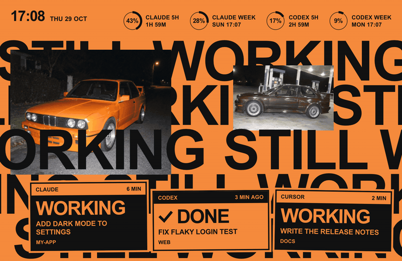<br>Pablo</a></td><td align="center"><a href="themes/in-colour">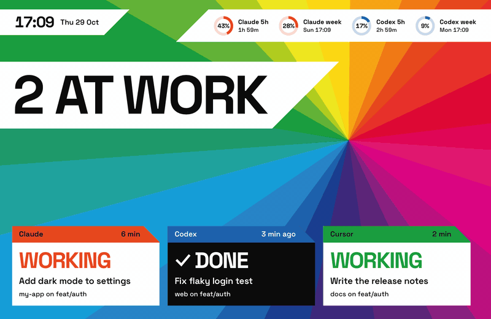<br>In Colour</a></td></tr>
<tr><td align="center"><a href="themes/currents">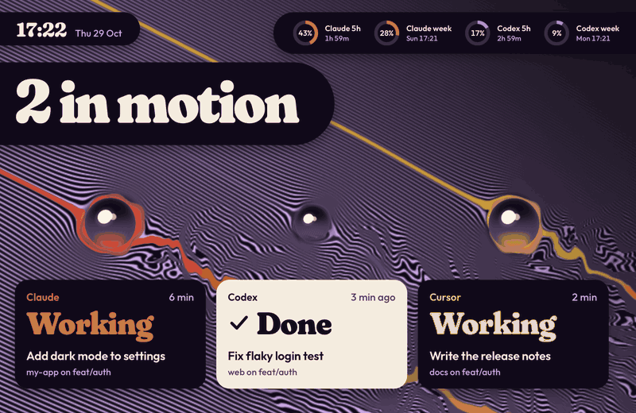<br>Currents</a></td><td align="center"><a href="themes/kid-a">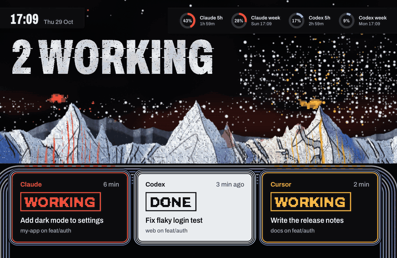<br>Kid A</a></td></tr>
<tr><td align="center"><a href="themes/unknown-pleasures">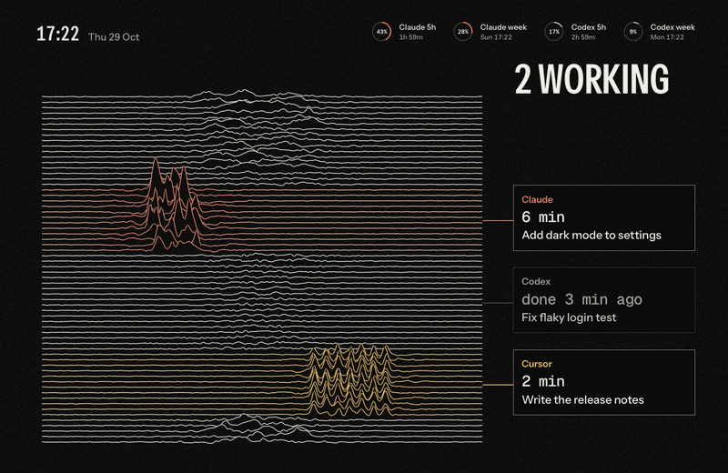<br>Unknown Pleasures</a></td><td align="center"><a href="themes/dark-side-of-the-moon">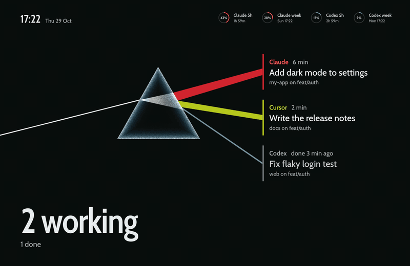<br>Prism</a></td></tr>
<tr><td align="center"><a href="themes/songs-in-the-key-of-life">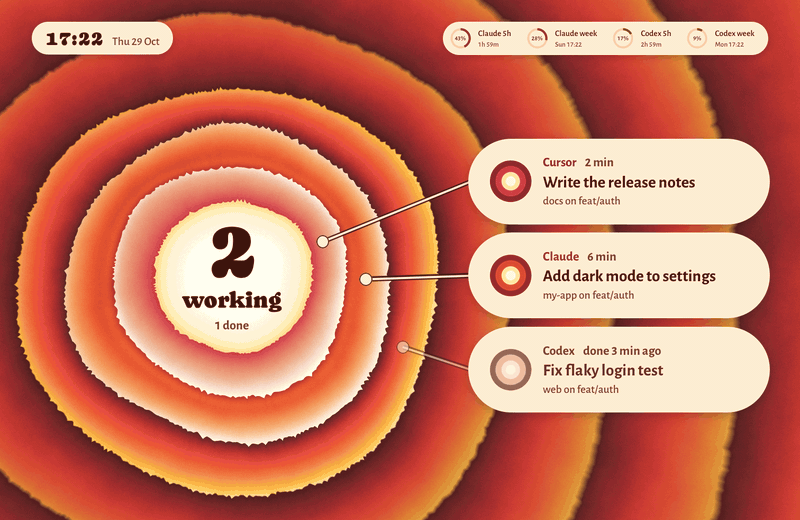<br>Key of Life</a></td><td align="center"><a href="themes/pinata">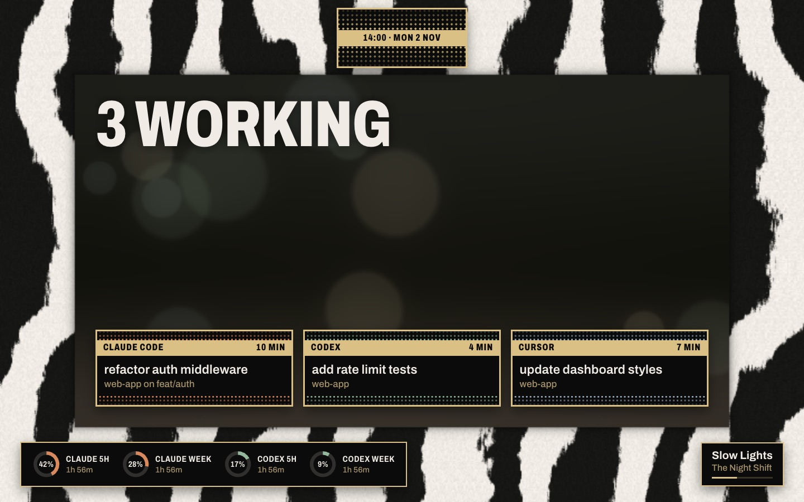<br>Piñata</a></td></tr>
</table>

| Theme | Still | Folder |
|---|---|---|
| Pablo |  | [themes/pablo](themes/pablo) |
| In Colour | 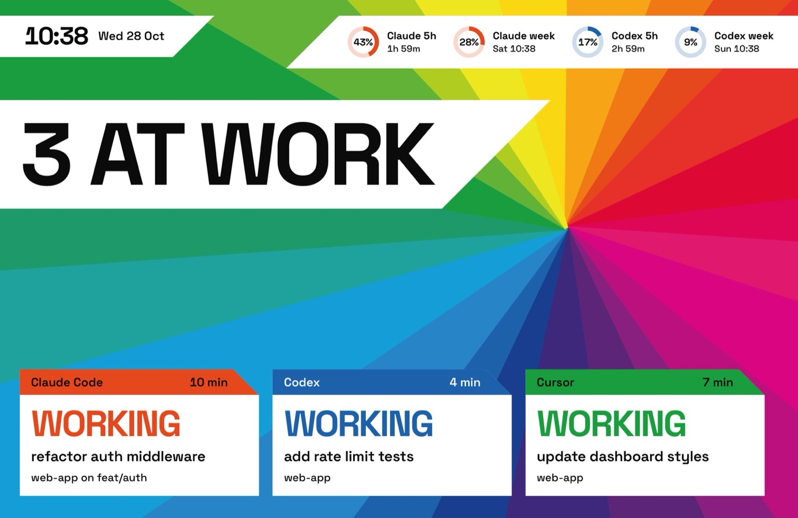 | [themes/in-colour](themes/in-colour) |
| Currents | 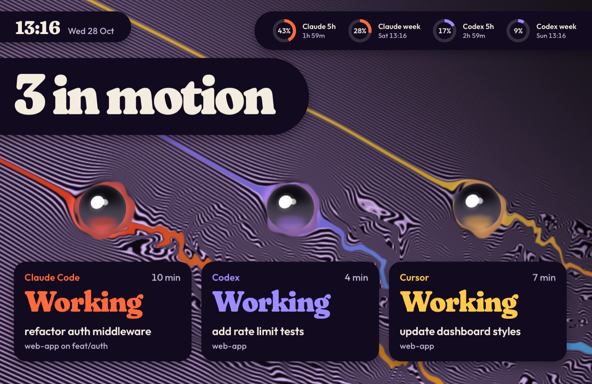 | [themes/currents](themes/currents) |
| Kid A | 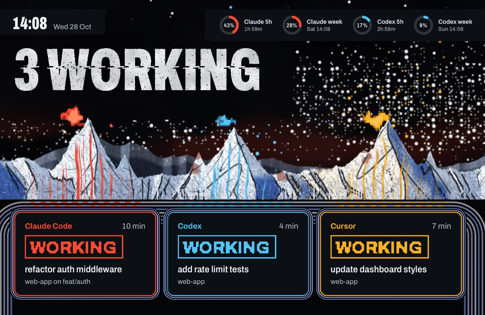 | [themes/kid-a](themes/kid-a) |
| Unknown Pleasures | 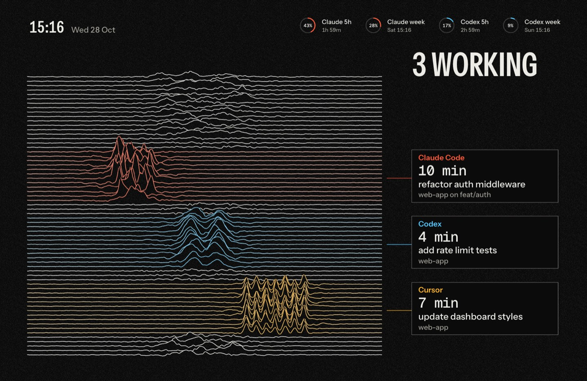 | [themes/unknown-pleasures](themes/unknown-pleasures) |
| Prism | 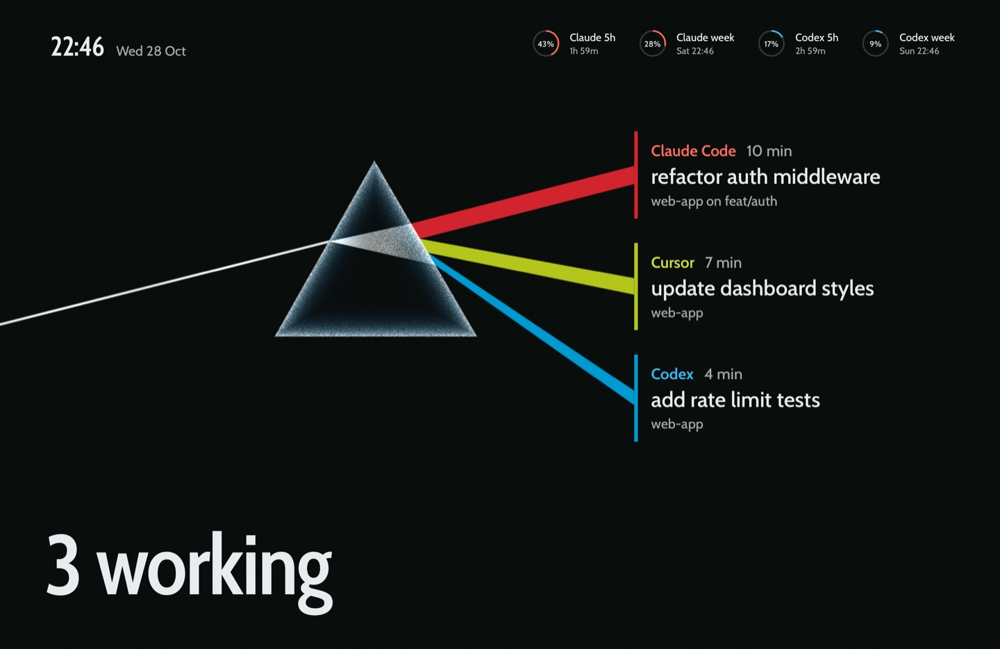 | [themes/dark-side-of-the-moon](themes/dark-side-of-the-moon) |
| Key of Life | 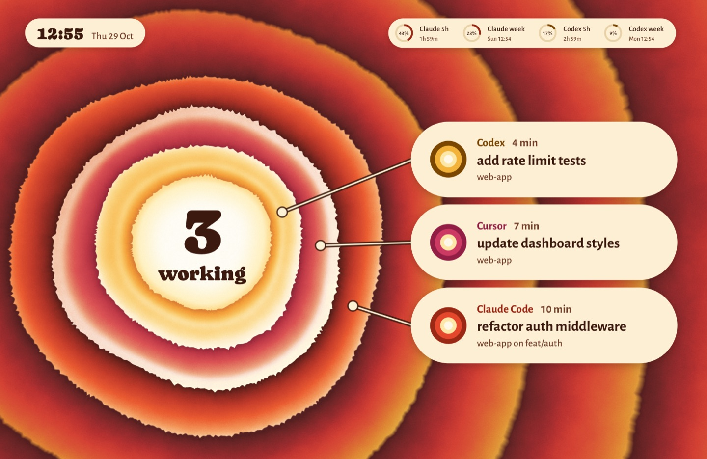 | [themes/songs-in-the-key-of-life](themes/songs-in-the-key-of-life) |
| Piñata |  | [themes/pinata](themes/pinata) |

All eight are fan-made tributes, inspired by album covers. They include no album artwork or logos.

## Install a theme

1. Download the theme zip (for example `pablo.zip`) from the Releases page of this repo.
2. Open the agent-screensaver settings window (search for Agent Screensaver in Spotlight) and drop the zip on it, or click Install… under Extensions and choose the zip. Dropping needs agent-screensaver 0.3.2 or later.
3. Pick the theme under Theme & background.

Each theme page lists its own zip name and theme id.

### In Terminal

Install does not put the `agent-screensaver` command on your PATH. Run it as `./agent-screensaver` from the unzipped agent-screensaver folder, or add this line to `~/.zshrc` and open a new Terminal window:

```
alias agent-screensaver='"$HOME/Library/Application Support/agent-screensaver/bin/agent-screensaver"'
```

Then:

```
agent-screensaver ext install pablo.zip
agent-screensaver theme set stavgayer.pablo
```

## Uninstall a theme

In the settings window, click Remove… next to the theme under Extensions (agent-screensaver 0.4.4 or later). Or in Terminal (see [In Terminal](#in-terminal) for the command):

```
agent-screensaver ext remove stavgayer.pablo
```

This removes the theme and its parts that no other theme uses.

## Build the zips yourself

```
scripts/pack.sh            # all themes
scripts/pack.sh pablo      # one theme
```

The zips are written to `dist/`. Each zip holds only the extension folders. The README and the `media` folder are left out.

`node scripts/check.mjs` checks every theme: each script parses, each manifest is valid, and all parts of a theme share one version. CI runs it and builds the zips on every push.

## Release

Bump the version of every theme you changed, in all of its parts. Then push an annotated tag whose message is the version, a blank line, then the notes: `git tag -a v1.1.2 --cleanup=verbatim -F notes.txt` and `git push origin v1.1.2`. CI checks that every changed theme has a new version, builds a zip for every theme and publishes the release with those notes.

## Contribute a theme

Read these two guides in the main repo first:

- [Create a theme](https://github.com/stavgayer/agent-screensaver/blob/main/docs/guides/create-a-theme.md)
- [Extensions](https://github.com/stavgayer/agent-screensaver/blob/main/docs/extensions.md)

Or let your coding agent do it with the [create-agent-screensaver-theme](skills/create-agent-screensaver-theme/SKILL.md) skill: it holds the method behind these themes (research, design, build, test), a starter theme and a preview page. Install it with the [skills CLI](https://github.com/vercel-labs/skills), which works with Claude Code, Codex, Cursor and other agents:

```bash
npx skills add stavgayer/agent-screensaver-themes --skill create-agent-screensaver-theme
```

Then fork or clone this repo and ask your agent for a theme from inside it. The preview page, `scripts/check.mjs` and `scripts/pack.sh` run from a copy of this repo.

Then follow these rules:

- Use your own prefix for every extension id, for example `yourname.mytheme`. Do not use `stavgayer.`.
- Add one folder per theme: `themes/<name>/`.
- Keep the pack layout. The theme folder holds one subfolder per extension, each with its own `extension.json`. There is no `extension.json` at the top of the theme folder.
- Put one still per state in `themes/<name>/media/` as JPEG, 1440 pixels wide, under 400 KB each. Use these names: `working`, `approval`, `done`, `idle`, `secondary`.
- Add a `README.md` in the theme folder. Say what the theme is, show the stills, give the install and uninstall commands, and list credits and licences for fonts and images. The skill's starter has a [README to start from](skills/create-agent-screensaver-theme/assets/starter/README.md).
- Add a row for the theme to the table of stills above.
- Run `scripts/pack.sh <name>` and check that the zip installs.

A theme inspired by an album must not include the album artwork or logos. Draw your own shapes in code or use images you have the right to use.

## Licence

MIT, see [LICENSE](LICENSE). Bundled fonts keep their own licences. Each font has its licence file next to it.
