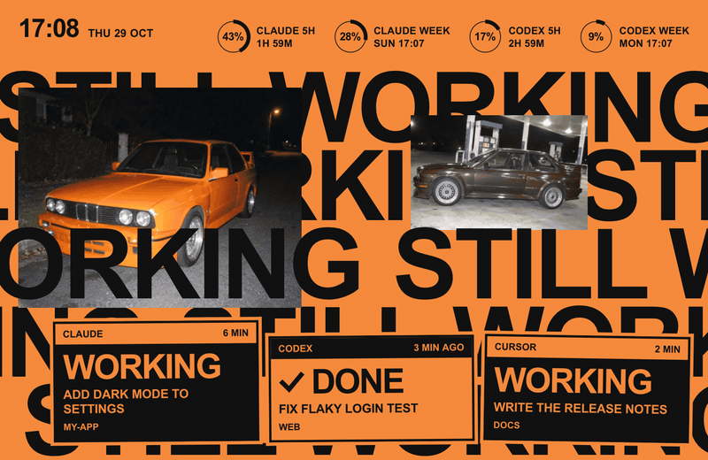
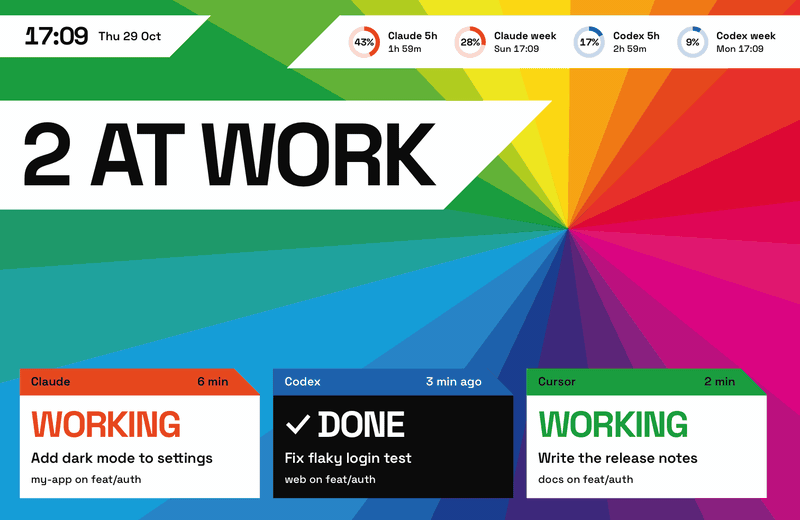
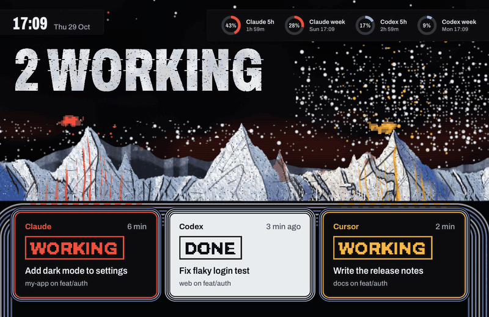
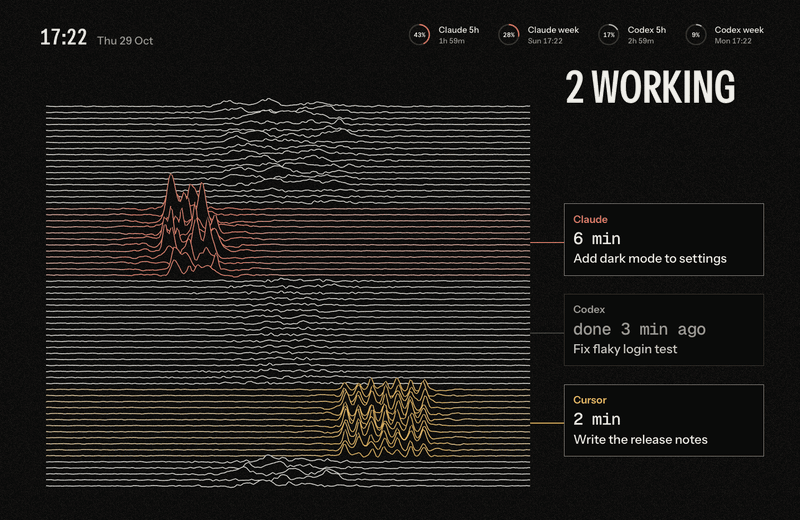
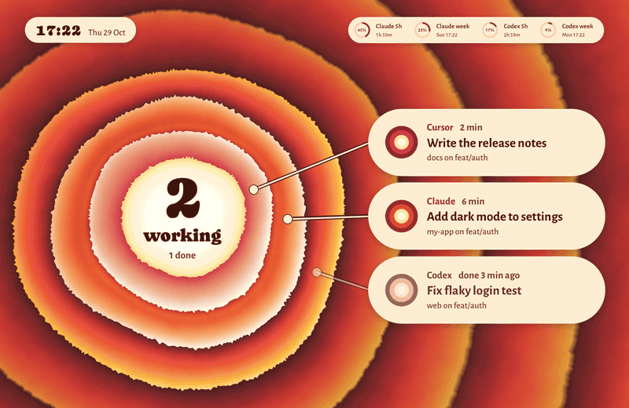
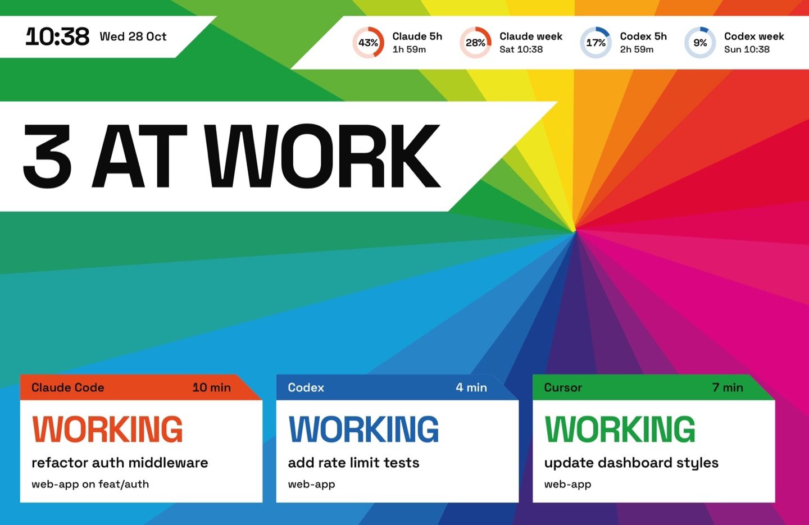
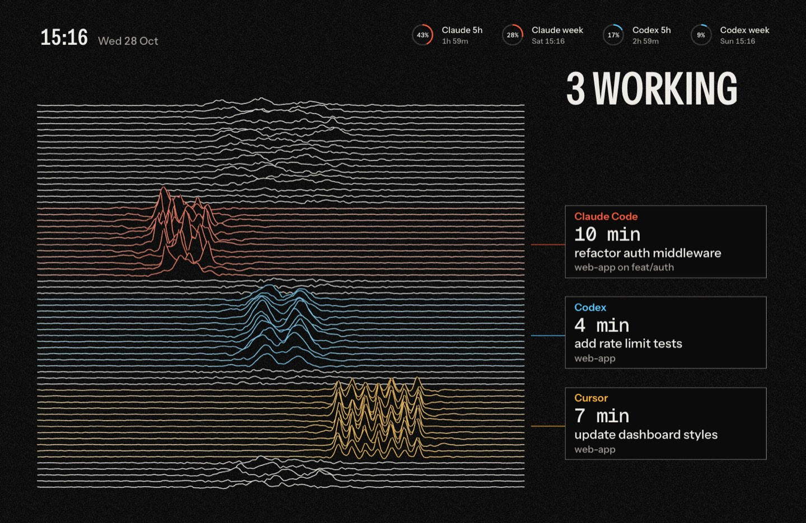

# agent-screensaver-themes

Community themes for [agent-screensaver](https://github.com/stavgayer/agent-screensaver), a macOS screen saver that shows what AI coding agents are doing.

Themes here need agent-screensaver 0.3.0 or later. That release is not out yet.

## Themes

<table>
<tr><td align="center"><a href="themes/pablo"><br>Pablo</a></td><td align="center"><a href="themes/in-colour"><br>In Colour</a></td></tr>
<tr><td align="center"><a href="themes/currents"><br>Currents</a></td><td align="center"><a href="themes/kid-a"><br>Kid A</a></td></tr>
<tr><td align="center"><a href="themes/unknown-pleasures"><br>Unknown Pleasures</a></td><td align="center"><a href="themes/dark-side-of-the-moon"><br>Prism</a></td></tr>
<tr><td align="center"><a href="themes/songs-in-the-key-of-life"><br>Key of Life</a></td><td></td></tr>
</table>

| Theme | Still | Folder |
|---|---|---|
| Pablo |  | [themes/pablo](themes/pablo) |
| In Colour |  | [themes/in-colour](themes/in-colour) |
| Currents |  | [themes/currents](themes/currents) |
| Kid A |  | [themes/kid-a](themes/kid-a) |
| Unknown Pleasures |  | [themes/unknown-pleasures](themes/unknown-pleasures) |
| Prism |  | [themes/dark-side-of-the-moon](themes/dark-side-of-the-moon) |
| Key of Life |  | [themes/songs-in-the-key-of-life](themes/songs-in-the-key-of-life) |

All seven are fan-made tributes, inspired by album covers. They include no album artwork or logos.

## Install a theme

1. Download the theme zip (for example `pablo.zip`) from the Releases page of this repo.
2. Run two commands:

```
agent-screensaver ext install pablo.zip
agent-screensaver theme set stavgayer.pablo
```

Each theme page lists its own zip name and theme id.

## Uninstall a theme

```
agent-screensaver ext remove stavgayer.pablo
```

This removes the theme and its parts that no other theme uses.

## Build the zips yourself

```
scripts/pack.sh            # all themes
scripts/pack.sh pablo      # one theme
```

The zips are written to `dist/`. Each zip holds only the extension folders. The README and the `media` folder are left out.

## Contribute a theme

Read these two guides in the main repo first:

- [Create a theme](https://github.com/stavgayer/agent-screensaver/blob/main/docs/guides/create-a-theme.md)
- [Extensions](https://github.com/stavgayer/agent-screensaver/blob/main/docs/extensions.md)

Then follow these rules:

- Use your own prefix for every extension id, for example `yourname.mytheme`. Do not use `stavgayer.`.
- Add one folder per theme: `themes/<name>/`.
- Keep the pack layout. The theme folder holds one subfolder per extension, each with its own `extension.json`. There is no `extension.json` at the top of the theme folder.
- Put one still per state in `themes/<name>/media/` as JPEG, 1440 pixels wide, under 400 KB each. Use these names: `working`, `approval`, `done`, `idle`, `secondary`.
- Add a `README.md` in the theme folder. Say what the theme is, show the stills, give the install and uninstall commands, and list credits and licences for fonts and images.
- Run `scripts/pack.sh <name>` and check that the zip installs.

A theme inspired by an album must not include the album artwork or logos. Draw your own shapes in code or use images you have the right to use.

## Licence

MIT, see [LICENSE](LICENSE). Bundled fonts keep their own licences. Each font has its licence file next to it.
