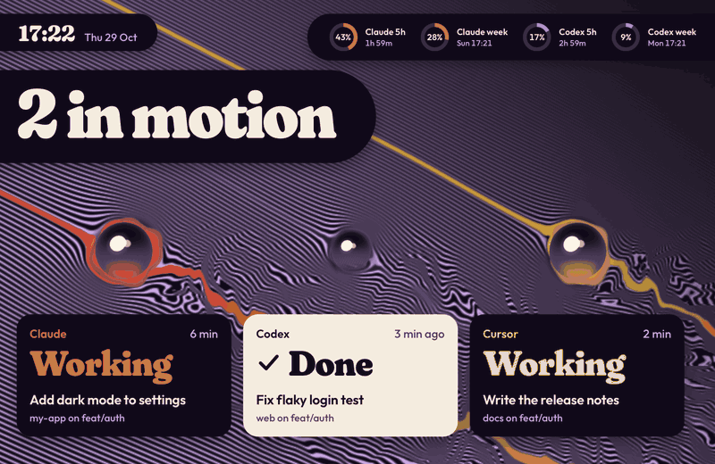
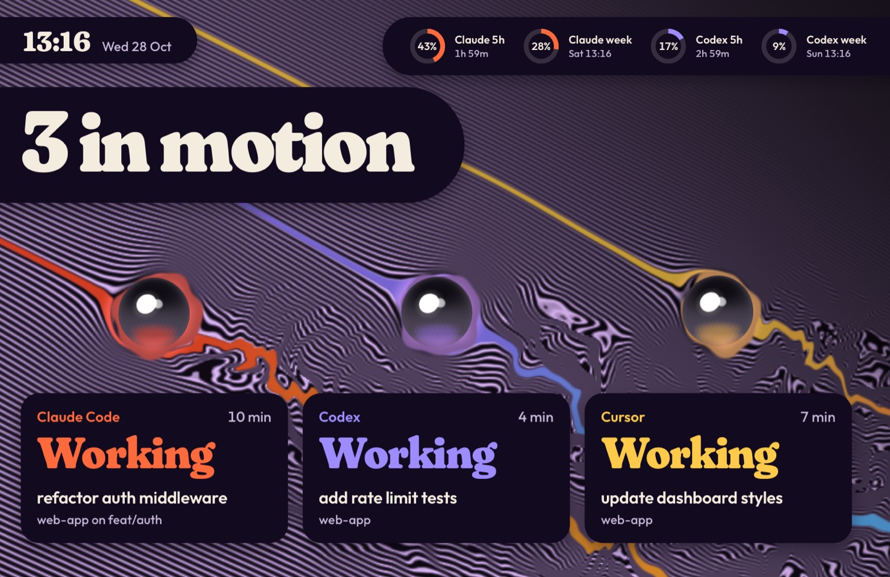
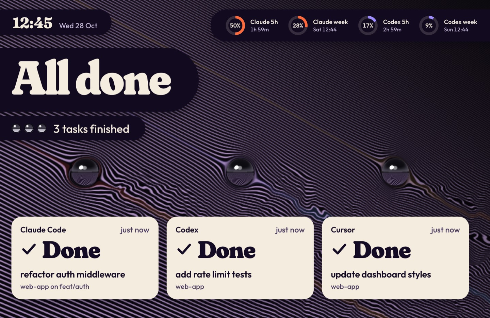
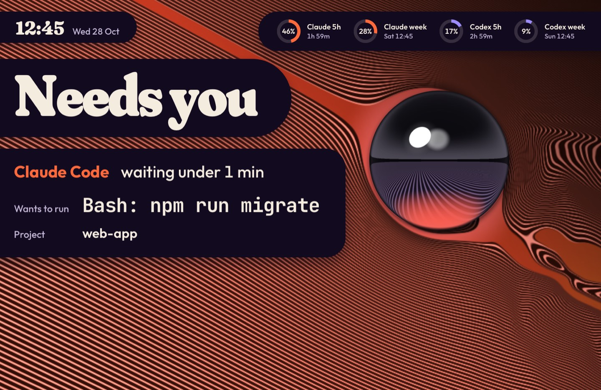
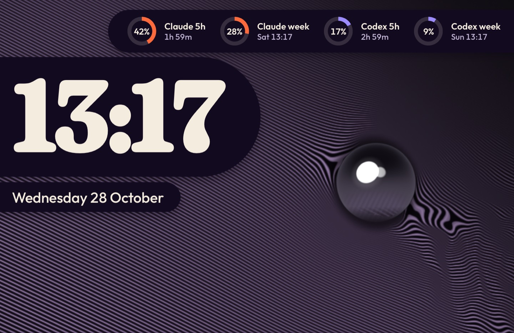
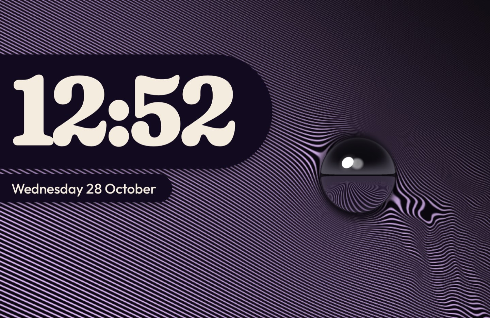

# Currents

A fan-made tribute theme for agent-screensaver. It is inspired by an album cover about turbulent flow: hundreds of thin lilac lines on a dark liquid surface, one dark chrome ball sitting in it, one red thread running into the ball, and a marbled wake behind it (vortex shedding). Here every agent is a ball in the surface, with its own coloured thread. The surface is drawn in code by a shader. No album artwork or logos are included.



Needs [agent-screensaver 0.3.0](https://github.com/stavgayer/agent-screensaver/releases/tag/v0.3.0) or later.

## What the screen shows

| State | Still |
|---|---|
| Agents working: one dark chrome ball per task, right above its card. Each ball's thread in the agent's own hue runs into it, pools around it, and leaves as a ribbon torn by the churning wake. `3 in motion` on a dark plate. |  |
| All done: the balls shrink, their threads fade, their wakes calm, and the surface dims. The cards turn to paper. `All done`. |  |
| An agent waits for you: one large ball, and the agent's colour floods the surface. `Needs you`, then one large card: the agent, how long it has waited, the exact command on one line, the project. |  |
| Nothing running: one chrome ball in a dim, calm surface. The time very large, the date, and the limit rings grow. |  |
| Second display: the surface and its one ball, with the time and the date only. |  |

Each agent owns one thread colour: Claude vermilion to orange, Codex lilac to blue, Cursor marigold to orange. Other agents get colours by their name. All text sits on dark plates or paper cards, so it reads everywhere on the surface. The approval command keeps one line and gets smaller to fit; only a very long command breaks, at spaces, into up to four lines. Privacy mode keeps working: titles, commands, names and branches are shown only when the service sends them. Without a command the approval card says "Look at the terminal".

## Motion

- Each ball sits sunk in a pool of its thread's colour and floats: it drifts and bobs by about 1.5% of its size and rocks very slightly, each ball on its own slow rhythm. The pool's edge wobbles, the lines at its waterline ripple, and the wake follows the ball. The lines upstream stand still.
- The wakes churn all the time: loops form, stretch, fold and drift downstream, and the threads wobble with them.
- The line pattern slides sideways by one line every 45 seconds, and the whole surface drifts a few pixels over 4 minutes (option `drift`). Both move pixels against burn-in.
- Balls and cards rise in with a spring, 70 ms apart. When a task finishes, its card takes a small press, the new word rises in, the ball shrinks and its thread fades.
- An approval is one move: the agent's colour floods the surface, the large ball lands, and the card slides in from the left and holds. Nothing pulses.
- The surface is a WebGL fragment shader. It renders at half size (option `scale`) and at most 30 frames a second (option `fps`), and stops when the screen saver stops. The balls are pictures rendered once per change. Cards and words animate only transform and opacity.
- With "Reduce motion" on in macOS, the surface is drawn once and stands still, the balls do not float, and things fade instead of moving.

## What is in this folder

| Folder | Type | What it does |
|---|---|---|
| `stavgayer.currents` | theme | Picks the current and the layout. |
| `stavgayer.currents-layout` | layout | Clock top left, rings top right, the board over the whole screen. A second display shows the board with the time only. |
| `stavgayer.currents-ground` | background | The lined surface, the balls, their threads and wakes, and the flood for an approval. Options: `drift` (minutes for one drift), `fps`, `scale`. |
| `stavgayer.currents-board` | component | The statement, the task cards and the approval card. Option `show`: `agents` (default) or `time`. |
| `stavgayer.currents-clock` | component | The time and the date in the corner. |
| `stavgayer.currents-rings` | component | The usage limits as rings in each agent's hue. |

The `media` folder holds the stills for this page. It is not part of the pack zip.

## Install

Download `currents.zip` from the Releases page of this repo. Open the agent-screensaver settings window (from the menu bar icon, or with Spotlight on 0.3.1 or later), go to Extensions, click Install… and choose `currents.zip`. Then pick the theme under Theme & background.

Or in Terminal:

```
agent-screensaver ext install currents.zip
agent-screensaver theme set stavgayer.currents
```

To build the zip yourself, run `scripts/pack.sh currents` from the root of this repo.

On a release that installs one extension at a time, run this from this folder instead, one folder per install:

```
for e in stavgayer.currents-board stavgayer.currents-clock stavgayer.currents-rings stavgayer.currents-ground stavgayer.currents-layout stavgayer.currents; do
  agent-screensaver ext install "./$e"
done
agent-screensaver theme set stavgayer.currents
```

## Uninstall

```
agent-screensaver ext remove stavgayer.currents
```

This removes the theme and its parts that no other theme uses. To switch to another theme first, run `agent-screensaver theme set builtin.chrome`.

## Options

To make the drift of the surface slower or faster (minutes for one drift):

```
agent-screensaver option set stavgayer.currents-ground drift 8
```

To use less power, lower the frame rate or the render scale:

```
agent-screensaver option set stavgayer.currents-ground fps 20
agent-screensaver option set stavgayer.currents-ground scale 0.35
```

## Credits and licences

- Theme code and manifests: MIT, see the `LICENSE` file at the root of this repo.
- Font: Fraunces, the display face, SIL Open Font License 1.1. From Google Fonts (github.com/google/fonts, `ofl/fraunces`). Files: `Fraunces.ttf` and `OFL-Fraunces.txt` in the `fonts` folder of `stavgayer.currents-board` and `stavgayer.currents-clock`.
- Font: Outfit, the text face, SIL Open Font License 1.1. From Google Fonts (github.com/google/fonts, `ofl/outfit`). Files: `Outfit.ttf` and `OFL-Outfit.txt` in the `fonts` folder of `stavgayer.currents-board`, `stavgayer.currents-clock` and `stavgayer.currents-rings`.
- Font: JetBrains Mono, for the command, SIL Open Font License 1.1. Files: `JetBrainsMono.woff2` and `OFL-JetBrainsMono.txt` in the `fonts` folder of `stavgayer.currents-board`.
- Fan-made tribute. Not affiliated with any artist or label.
