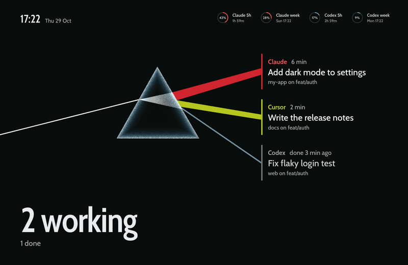
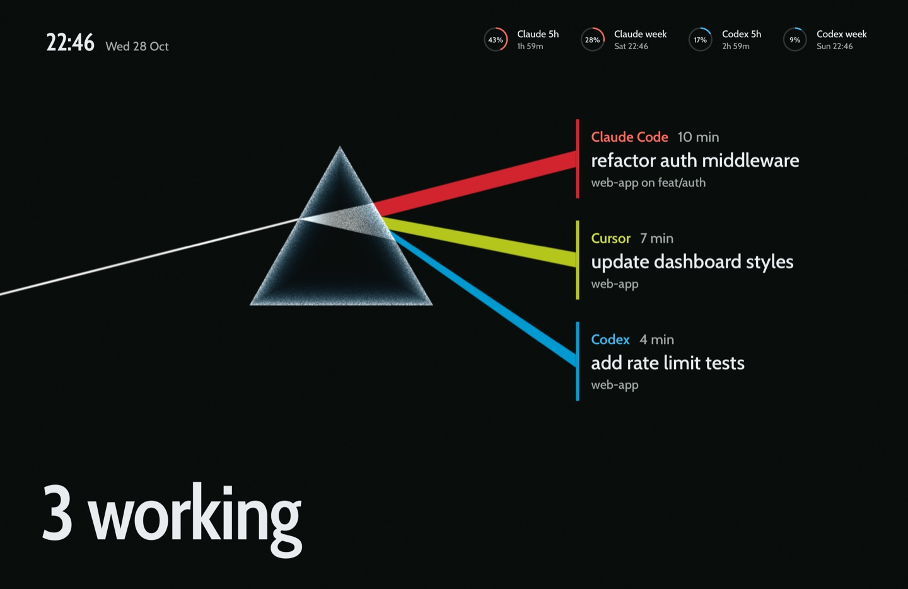
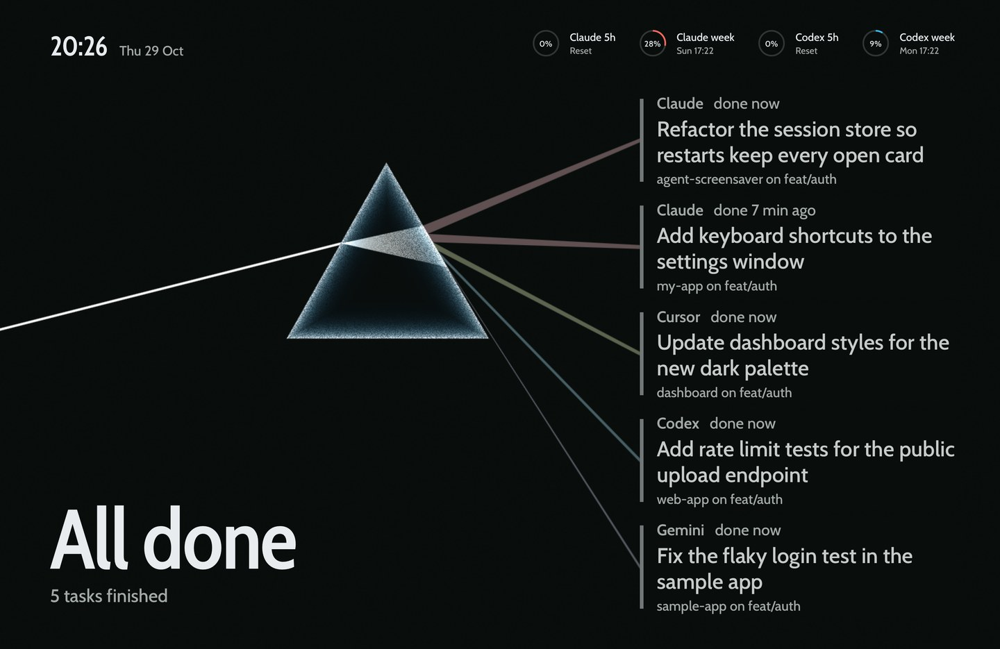
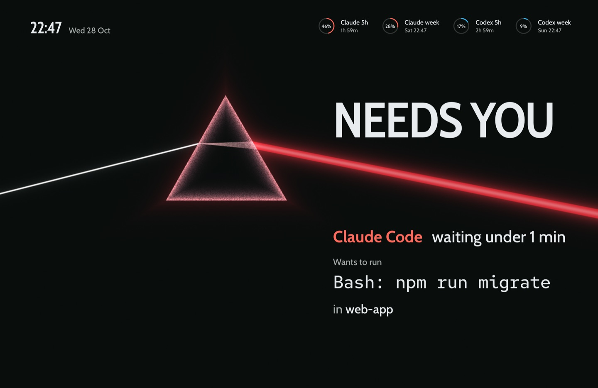
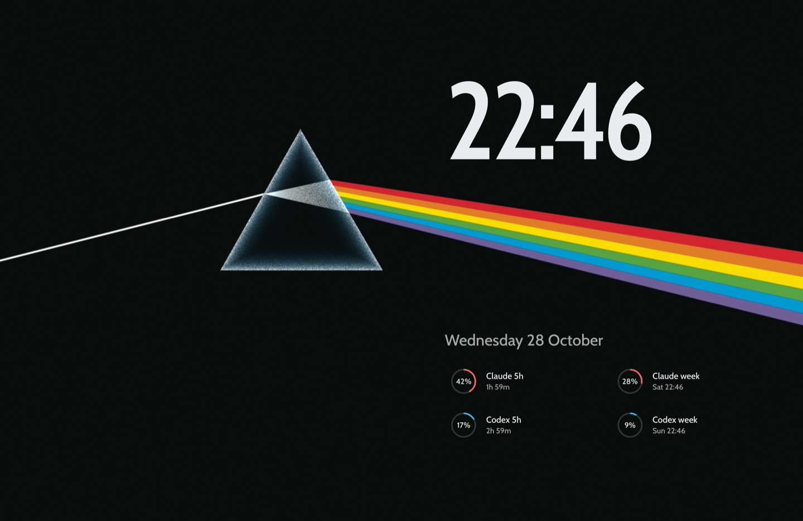
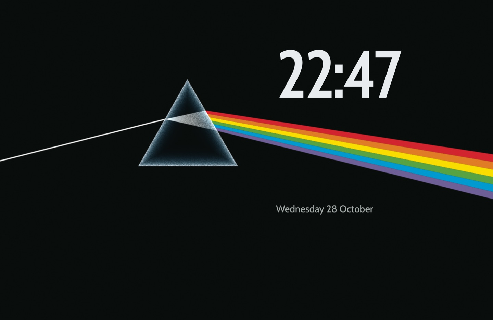

# Prism

A fan-made tribute theme for agent-screensaver. It is inspired by a record sleeve from 1973, designed by Hipgnosis with the line work by George Hardie: a thin white beam on a black field enters a glass prism and leaves it as six flat bands of colour. Hardie based his drawing on a photograph of a prism in a physics book. Inside the gatefold the bands run on and turn into the blip of a heart monitor. Here the spectrum is the graph of your agents: each task owns one band in its agent's colour, its card stands at the end of that band like an entry in a legend, and when an agent needs you the spectrum folds into one beam across the screen. Everything is drawn in code, in a shader, from the proportions of the sleeve. No album artwork, lettering or logos are included.



Needs [agent-screensaver 0.3.0](https://github.com/stavgayer/agent-screensaver/releases/tag/v0.3.0) or later.

## What the screen shows

| State | Still |
|---|---|
| Agents working: each task owns one band of the spectrum, in its agent's colour. The bands fan out from the prism to the cards, top to bottom in the order of the spectrum, and a band grows wider the longer its task has run. Each card stands at the end of its band: the agent in its colour, the time, the task on one or two lines and the project. The count, `3 working`, stands large at the bottom left. The white beam shimmers a little. |  |
| All done: each band thins and turns back toward white light, and the fan grows faint and quiet. The cards say `done`, and the count says `All done`. |  |
| An agent waits for you: the spectrum folds into one beam in that agent's colour that runs to the edge of the screen, and the prism glows with it. `NEEDS YOU` stands large above the beam. Under it: the agent, how long it has waited, the exact command and the project. |  |
| Nothing running: the picture at rest, six bands running off the right edge. The time very large above the bands, the date and the limit rings under them. Every 26 seconds a heartbeat passes slowly along the bands. |  |
| Second display: the picture at rest with the time and the date. |  |

Each agent owns one colour of the spectrum: Claude red, Codex blue, Cursor yellow-green. Other agents get orange, yellow, green or violet by their name. The bands keep the flat, muted colours of print; the names of the agents use a lighter tint of the same colour so they read on black. All text stands on the black field, clear of the glass and the beam. The approval command keeps one line and gets smaller to fit; a very long command breaks at spaces into up to four lines. Up to seven cards are shown; more cards add a `+2 more` line. Privacy mode keeps working: titles, commands, names and branches are shown only when the service sends them. Without a command the approval says "Look at the terminal".

## Motion

- When a task starts, its band shoots out from the prism on a spring, and its card lands at the end of it.
- When a task finishes, its band thins and fades toward white, and its card moves a hair as its time line rises in.
- An approval is one move: the bands fold into one beam, the prism glows, and `NEEDS YOU` lands above the beam a beat later, then who, what and where under it. Nothing pulses.
- The white beam shimmers slowly while agents work. At rest a heartbeat passes along the bands every 26 seconds.
- The prism and the beam sway a few pixels over 4 minutes, drawn with the light itself so they glide, so no pixel stays lit in one place. The words do not sway, since text moved by fractions of a pixel shimmers, and the bands still end at their cards.
- The light is one WebGL draw of one triangle over the screen. It draws 30 frames a second (option `fps`) while something changes or moves, and 10 while the light stands still, so the sway glides, at half the screen's pixels (option `scale`), and not at all while the page is hidden. Cards and words animate only transform and opacity.
- With "Reduce motion" on in macOS, the light is drawn once for each change and stands still: no shimmer, no heartbeat, no sway, and words fade instead of moving.

## What is in this folder

| Folder | Type | What it does |
|---|---|---|
| `stavgayer.dsotm` | theme | Picks the light and the layout. |
| `stavgayer.dsotm-layout` | layout | The board, the clock and the rings over the whole screen. A second display shows the board with the time only. |
| `stavgayer.dsotm-ground` | background | The light: the beam, the prism, the spectrum, the bands of the agents, the beam of an approval. Options: `fps`, `scale`. |
| `stavgayer.dsotm-board` | component | The count, the cards at the ends of the bands, the approval, the large time. Option `show`: `agents` (default) or `time`. |
| `stavgayer.dsotm-clock` | component | The time and the date, small, in the top left corner while tasks run. |
| `stavgayer.dsotm-rings` | component | The usage limits as rings: in the top right corner while tasks run, under the spectrum when nothing runs. |

The `media` folder holds the stills for this page. It is not part of the pack zip.

## Install

Download `dark-side-of-the-moon.zip` from the Releases page of this repo. Open the agent-screensaver settings window (from the menu bar icon, or with Spotlight on 0.3.1 or later), go to Extensions, click Install… and choose `dark-side-of-the-moon.zip`. Then pick the theme under Theme & background.

Or in Terminal:

```
agent-screensaver ext install dark-side-of-the-moon.zip
agent-screensaver theme set stavgayer.dsotm
```

To build the zip yourself, run `scripts/pack.sh dark-side-of-the-moon` from the root of this repo.

On a release that installs one extension at a time, run this from this folder instead, one folder per install:

```
for e in stavgayer.dsotm-board stavgayer.dsotm-clock stavgayer.dsotm-rings stavgayer.dsotm-ground stavgayer.dsotm-layout stavgayer.dsotm; do
  agent-screensaver ext install "./$e"
done
agent-screensaver theme set stavgayer.dsotm
```

## Uninstall

```
agent-screensaver ext remove stavgayer.dsotm
```

This removes the theme and its parts that no other theme uses. To switch to another theme first, run `agent-screensaver theme set builtin.chrome`.

## Options

To use less power, lower the frame rate or the render scale:

```
agent-screensaver option set stavgayer.dsotm-ground fps 15
agent-screensaver option set stavgayer.dsotm-ground scale 0.35
```

The light never draws at less than one pixel per screen point, so the edges stay crisp at any scale.

## Credits and licences

- Theme code and manifests: MIT, see the `LICENSE` file at the root of this repo.
- Font: Cabin, by Impallari Type and Rodrigo Fuenzalida, for all the words (its condensed width for the big words), SIL Open Font License 1.1. From Google Fonts (github.com/google/fonts, `ofl/cabin`). It is a humanist sans inspired by the typefaces of Edward Johnston and Eric Gill; the lyrics inside the 1973 gatefold are set in Gill Sans. Files: `Cabin.ttf` and `OFL-Cabin.txt` in the `fonts` folder of `stavgayer.dsotm-board`, `stavgayer.dsotm-clock` and `stavgayer.dsotm-rings`.
- Font: Red Hat Mono, by MCKL, for the command, SIL Open Font License 1.1. From Google Fonts (github.com/google/fonts, `ofl/redhatmono`). Files: `RedHatMono.ttf` and `OFL-RedHatMono.txt` in the `fonts` folder of `stavgayer.dsotm-board`.
- The history of the sleeve: "Under the covers" in Hi-Fi News, the People's Graphic Design Archive entry for the record, and the project page of the 50th anniversary box set by Pentagram.
- Fan-made tribute. Not affiliated with any artist, designer or label.
