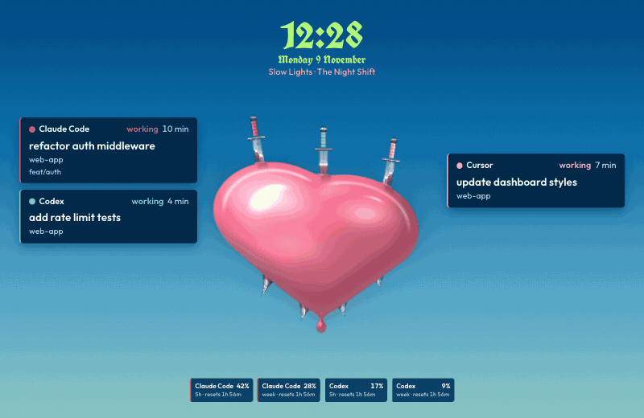
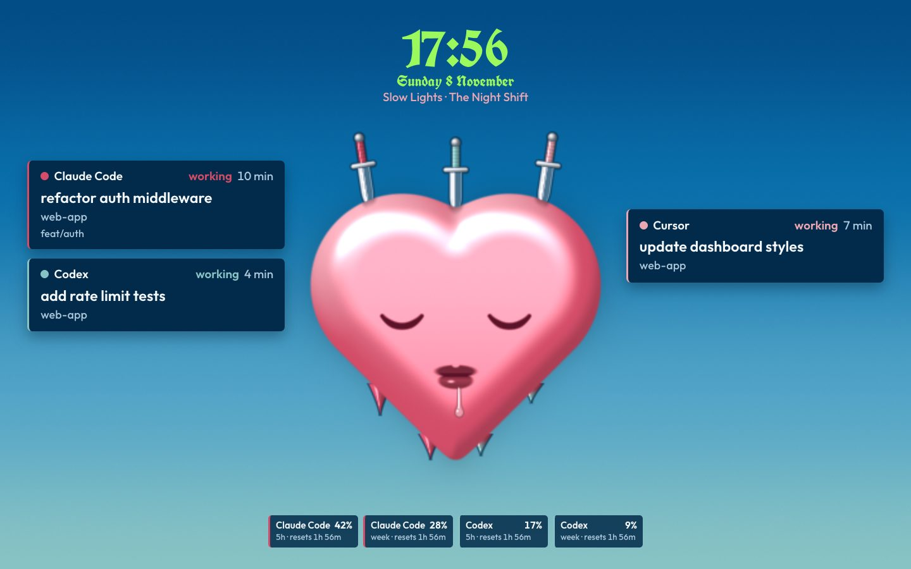
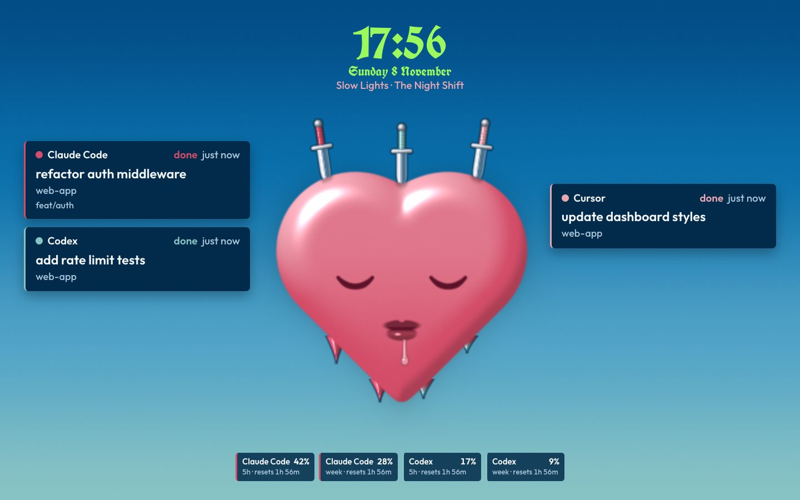
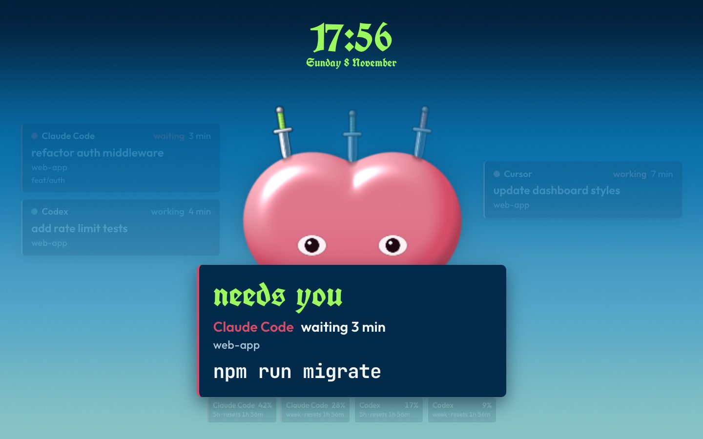
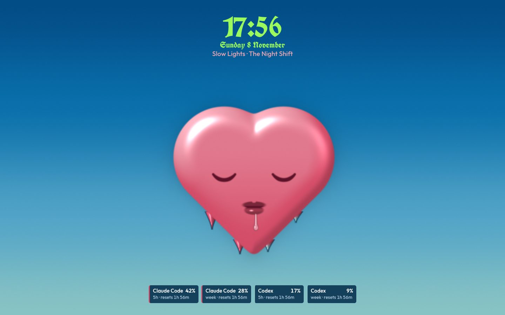
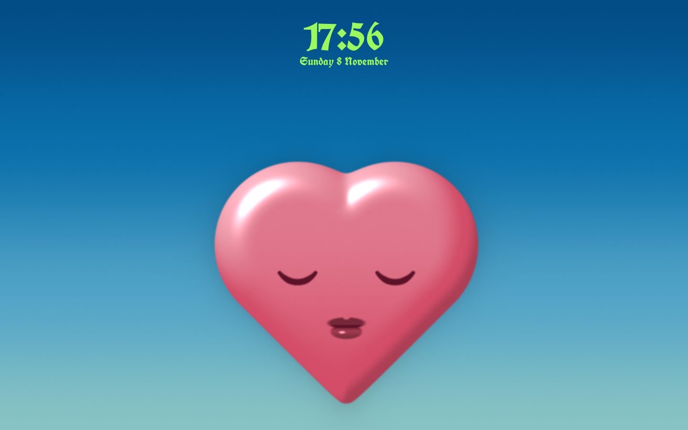

# Favourite

A fan-made tribute theme for agent-screensaver. It is inspired by the cover of the Fontaines D.C. single Favourite (2024), art by Lulu Lin: a glossy pink heart-shaped face with shut eyes, low in a blue sky, with silver daggers in its top edge and the title in acid-lime blackletter at the top. Here each task is a dagger in the heart, each usage limit is a spike under it, the song is a drip from its lip, and when an agent needs you the eyes open. Everything is drawn in code. No artwork, photos of it, or logos are included.



Needs [agent-screensaver 0.5.0](https://github.com/stavgayer/agent-screensaver/releases/tag/v0.5.0) or later.

## What the screen shows

| State | Still |
|---|---|
| Agents working: one silver dagger stands in the top edge of the heart for each task, up to seven, with a handle in the agent's colour. Each task also gets a dark blue card in the sky beside the heart, with the agent, how long it has run, the task, the project and the branch. A dagger sinks very slowly into the heart over the first hour. When more tasks run than the columns can hold, the last card says `+N more`. On 4:3 and 5:4 screens the cards go in one row under the limits. |  |
| All done: every dagger stays where it is and glints one time. The cards say `done`. Nothing moves. When the app clears the finished tasks, each dagger slides out and falls away. |  |
| An agent waits for you: the eyes open, the sky goes to its deepest blue, the waiting agent's dagger turns lime and the other daggers dim. The cards and the limits fade back, and one large card sits over the lower half of the heart: `needs you` in lime blackletter, the agent, how long it has waited, the project and the exact command. If more than one agent waits, the one that has waited longest shows, with a line `+N more waiting`. The song hides. |  |
| Nothing running: the heart alone, low in the sky, eyes shut, no daggers. The time in lime blackletter at the top centre, the date under it, and the usage limits under the heart. |  |
| Second display: the sky, the heart with shut eyes, the time and the date. |  |

Each usage limit is one glossy spike under the heart, in its agent's colour. It grows longer the more of the limit is used, and it is never shorter than 15% of its full length, so it stays visible. A small dark blue plate under each spike gives the agent, the window (`5h`, `week` or `plan`), the percent used and when it resets. A limit the app has not read is left out. A reading that is old says `est.` or `Reset`.

With "Show what's playing" on, the title and the artist show in one small pink line under the date, and a thin drip hangs from the heart's lip. The drip grows as the song plays and falls when it ends. A song that Music streams has no length, so its drip hangs at half length and stays. The song hides while an agent waits for you, and it never shows on the second display.

Each agent owns one colour from the cover: Claude red `#d34d68`, Codex sea green `#87c2c4`, Cursor pink `#eba6b3`. Other agents get one of those or a light silver by their name. Every dagger handle has a thin dark outline so it reads on the sky. Lime is kept for the time, the date, `needs you` and the dagger of a waiting agent. All small text sits on dark blue plates, so it reads over the sky. Privacy mode keeps working: titles, commands and branches show only when the service sends them. Without a command the approval says "Look at the terminal".

## Motion

- The heart breathes: a very slow swell of about 1.5% every 8 seconds. A soft sheen slides across its gloss every 30 seconds.
- The whole picture drifts a few pixels over minutes, so no pixel stays lit in one place. Option `drift` sets the minutes for one drift (4 by default).
- One move for each event. A new task stabs a dagger in with one short move. A finished task glints once. An agent that needs you opens the eyes, the only fast move, and the sky goes deep blue over about a second.
- The background is one WebGL shader. It draws at half size (option `scale`) and 12 frames a second (option `fps`, at most 30), and it starts again on its own if the graphics card resets.
- With "Reduce motion" on in macOS, the picture stands still and is drawn again only when something changes. The eyes cross-fade from shut to open, and daggers fade in and out instead of moving.

## What is in this folder

| Folder | Type | What it does |
|---|---|---|
| `stavgayer.favourite` | theme | Picks the background and the layout. |
| `stavgayer.favourite-layout` | layout | The board over the whole screen. A second display shows the board with the time only. |
| `stavgayer.favourite-ground` | background | The sky, the heart, the daggers, the spikes and the drip. Options: `fps`, `scale`, `drift`. |
| `stavgayer.favourite-board` | component | The time and the date, the song, the task cards, the limit plates and the needs-you card. Option `show`: `agents` (default) or `time`. |

The `media` folder holds the stills and the demo for this page. It is not part of the pack zip.

## Install

Download `favourite.zip` from the Releases page of this repo. Open the agent-screensaver settings window, drop the zip on it or click Install… under Extensions, then pick the theme under Theme & background.

Or in Terminal, with the `agent-screensaver` command set up as the [main README](../../README.md#in-terminal) shows:

```
agent-screensaver ext install favourite.zip
agent-screensaver theme set stavgayer.favourite
```

To build the zip yourself, run `scripts/pack.sh favourite` from the root of this repo.

## Uninstall

```
agent-screensaver ext remove stavgayer.favourite
```

This removes the theme and its parts that no other theme uses.

## Options

To use less power, lower the frame rate or the render scale. To move the picture more slowly, raise the minutes for one drift:

```
agent-screensaver option set stavgayer.favourite-ground fps 10
agent-screensaver option set stavgayer.favourite-ground scale 0.35
agent-screensaver option set stavgayer.favourite-ground drift 8
```

## Credits and licences

- Theme code and manifests: MIT, see the `LICENSE` file at the root of this repo.
- Font: UnifrakturCook, for the time, the date and `needs you`, SIL Open Font License 1.1. Files: `UnifrakturCook-Bold.ttf` and `OFL-UnifrakturCook.txt` in the `fonts` folder of `stavgayer.favourite-board`.
- Font: Outfit, for the cards, the plates and the song, SIL Open Font License 1.1. Files: `Outfit.ttf` and `OFL-Outfit.txt` in the `fonts` folder of `stavgayer.favourite-board`.
- Font: JetBrains Mono, for the approval command, SIL Open Font License 1.1. Files: `JetBrainsMono.woff2` and `OFL-JetBrainsMono.txt` in the `fonts` folder of `stavgayer.favourite-board`.
- Fan-made tribute. Not affiliated with Fontaines D.C., Lulu Lin or their label.
