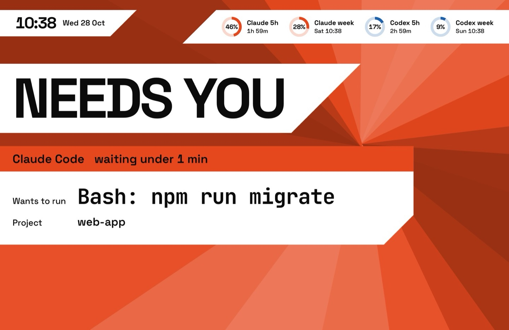
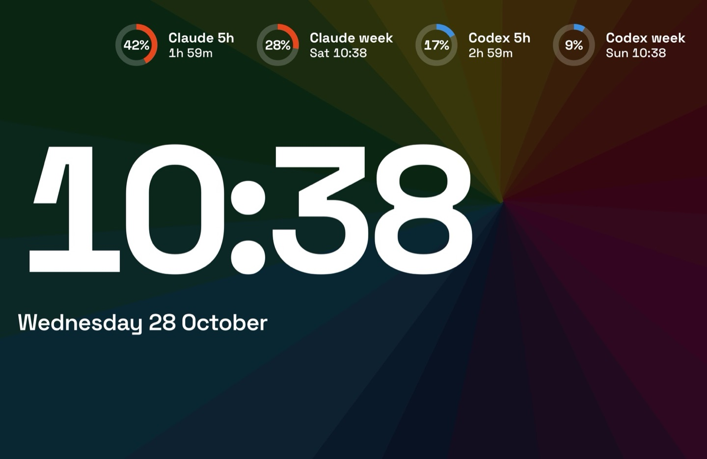
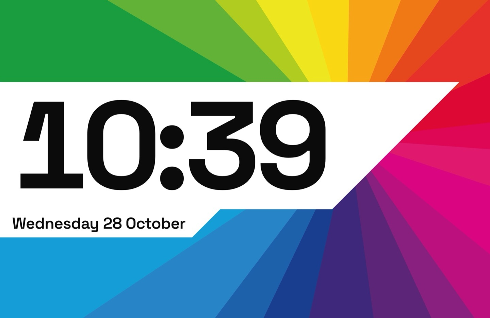

# In Colour

A fan-made tribute theme for agent-screensaver. It is inspired by an album cover of hard-edged colour wedges fanned out from one point, with one white bar cut at 45 degrees. The wheel is drawn in code. No album artwork or logos are included.


Needs [agent-screensaver 0.3.0](https://github.com/stavgayer/agent-screensaver/releases/tag/v0.3.0) or later.

## What the screen shows

| State | Still |
|---|---|
| Agents working: the full spectrum turns very slowly. One white card per task, with a band in the agent's own hue. |  |
| All done: a dark veil settles on the wheel, and `ALL DONE` shows in white. |  |
| An agent waits for you: the agent's hue blooms from the centre and one large card shows the command. |  |
| Nothing running: the dark wheel, the time very large, and the date. |  |
| Second display: the time and the date only. |  |

With "Show what's playing" on in agent-screensaver 0.4.0 or later, the song that Spotify or Music plays gets a white leg of its own, cut at 45 degrees like the others: a small ring that fills as the song plays, the song, and its artist. It hangs under the lowest leg shown and stays above the task cards. On the dark wheel at rest it drops its white bar and turns white, like the rest. It steps away while an agent waits for you. A song that Music streams has no ring, because Music gives no length for it.

Each agent owns one hue: Claude vermilion, Codex blue, Cursor green. Other agents get a hue by their name. Privacy mode keeps working: titles, commands, names and branches are shown only when the service sends them.

With "Reduce motion" on in macOS, the wheel and the words stand still, and things fade instead of moving.

## What is in this folder

| Folder | Type | What it does |
|---|---|---|
| `stavgayer.incolour` | theme | Picks the wheel and the layout. |
| `stavgayer.incolour-layout` | layout | Clock top left, rings top right, the board over the whole screen. A second display shows the board with the time only. |
| `stavgayer.incolour-ground` | background | The wheel, the one-hue wheel for an approval, and the dark veil. Option `turn`: minutes per turn. |
| `stavgayer.incolour-board` | component | The statement, the task cards, the song and the approval card. Option `show`: `agents` (default) or `time`. |
| `stavgayer.incolour-clock` | component | The time and the date in the corner. |
| `stavgayer.incolour-rings` | component | The usage limits as rings in each agent's hue. |

The `media` folder holds the stills for this page. It is not part of the pack zip.

## Install

Download `in-colour.zip` from the Releases page of this repo. Open the agent-screensaver settings window (from the menu bar icon, or with Spotlight on 0.3.1 or later), go to Extensions, click Install… and choose `in-colour.zip`. Then pick the theme under Theme & background.

Or in Terminal:

```
agent-screensaver ext install in-colour.zip
agent-screensaver theme set stavgayer.incolour
```

To build the zip yourself, run `scripts/pack.sh in-colour` from the root of this repo.

## Uninstall

```
agent-screensaver ext remove stavgayer.incolour
```

This removes the theme and its parts that no other theme uses. To switch to another theme first, run `agent-screensaver theme set builtin.chrome`.

## Options

To turn the wheel faster or slower (minutes per turn):

```
agent-screensaver option set stavgayer.incolour-ground turn 20
```

## Credits and licences

- Theme code and manifests: MIT, see the `LICENSE` file at the root of this repo.
- Font: Space Grotesk, SIL Open Font License 1.1. Files: `SpaceGrotesk.ttf` and `OFL-SpaceGrotesk.txt` in the `fonts` folder of `stavgayer.incolour-board`, `stavgayer.incolour-clock` and `stavgayer.incolour-rings`.
- Font: JetBrains Mono, SIL Open Font License 1.1. Files: `JetBrainsMono.woff2` and `OFL-JetBrainsMono.txt` in the `fonts` folder of `stavgayer.incolour-board`.
- Fan-made tribute. Not affiliated with any artist or label.
