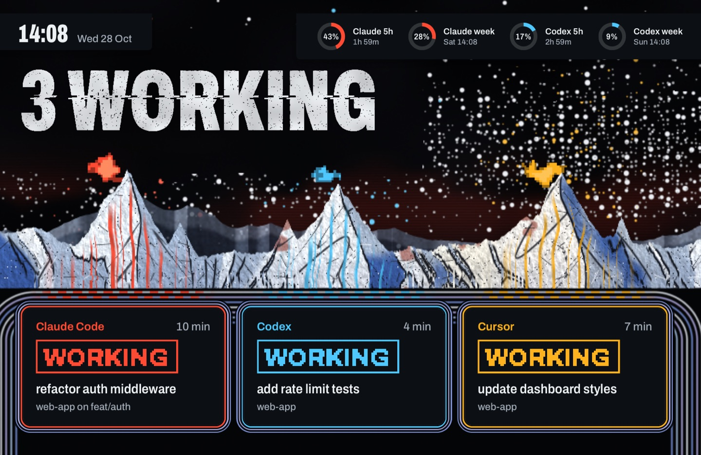
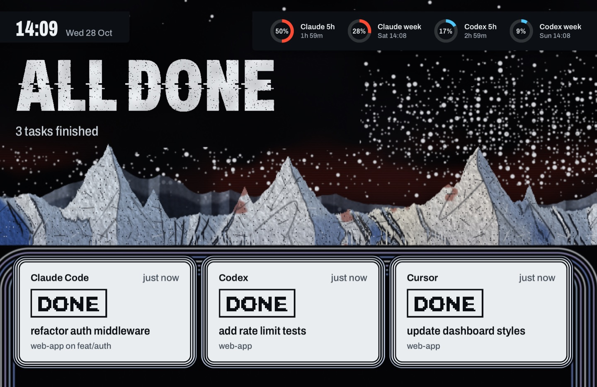
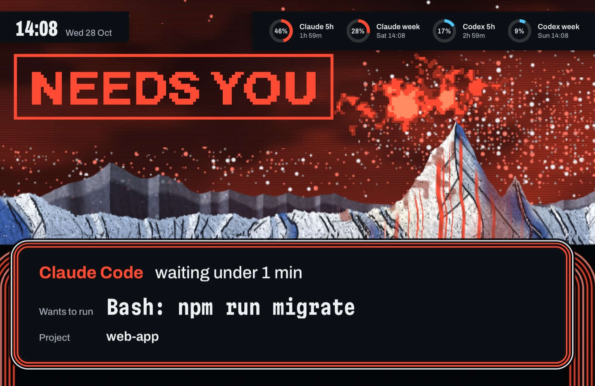
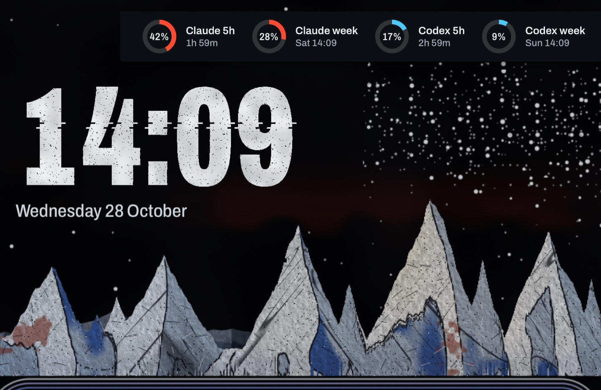
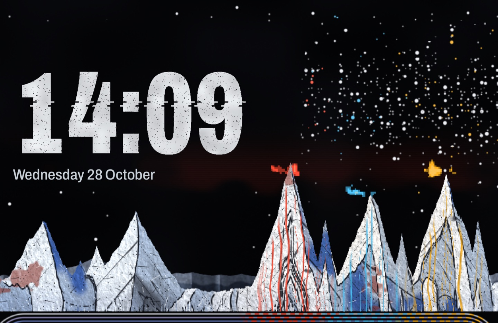

# Kid A

A fan-made tribute theme for agent-screensaver. It is inspired by an album cover that was made in a strange way: thick putty, soot and red stain were painted onto canvas and scraped with knives and sticks, the paintings were photographed, and software turned the brightness of each picture into a landscape, so bright became peak and dark became valley. The result is a range of cracked, ice-white peaks under a black sky with a red band and small fires. Here the data of your agents raises the range: every agent is one ridge, right above its card. The ridges carry the material of the paintings: grain and putty relief, soot rubbed into the valleys, a few red oil stains, and hairline scratches from a stick. The big words look printed and scanned: worn at the edges, with small pits and two rows dragged sideways. The range is drawn in code by a shader. No album artwork or logos are included.

Needs agent-screensaver 0.3.0 or later. That release is not out yet.

## What the screen shows

| State | Still |
|---|---|
| Agents working: one ridge per task, right above its card. The ridge grows with the time the task has run. The agent's colour runs down the face in thin stains, a small pixel fire burns over the summit, and the colour travels along the conduits under the range. `3 WORKING`, and one card per task in a frame of nested lines, with a pixel stamp `WORKING` in the agent's colour. |  |
| All done: the stains stop, the fires go out, and the ridges freeze white. Soot marks stay in the snow. The cards turn to snow, with a stamp `DONE`. `ALL DONE`. |  |
| An agent waits for you: its ridge stands tall, a great fire burns over it, the sky and the dots turn its colour, and the conduits fill. A pixel stamp `NEEDS YOU`, then one wide card: the agent, how long it has waited, the exact command, the project. |  |
| Nothing running: the range comes down to the foot of the screen and fills it, with no colour, under a wide dot sky. The time very large, the date, and the limit rings grow. |  |
| Second display: the full range, with the task ridges on the right, and the time and the date only. |  |

Each agent owns one colour: Claude red, Codex ice blue, Cursor amber. Other agents get colours by their name. All small text sits on near-black plates or snow-white cards, and the big words stand on the black sky with the dots kept away from them, so text reads everywhere. The approval command keeps one line and gets smaller to fit; only a very long command breaks, at spaces, into up to four lines. Privacy mode keeps working: titles, commands, names and branches are shown only when the service sends them. Without a command the approval card says "Look at the terminal".

## Motion

- The dot sky drifts slowly sideways and each dot twinkles a little. The whole range drifts a few pixels over 4 minutes (option `drift`). Both move pixels against burn-in.
- The stains run down the working ridges, the fires flicker in coarse pixels, and the colour moves along the conduits in dashes. Now and then the foot of the range is dragged down into bars and a thin band is dragged sideways, like a scan smeared in an editor; these come and go slowly.
- Cards rise in with a spring, 70 ms apart. When a task finishes, its card takes a small press and its stamp loads in again.
- The big words are drawn once each time they change (once a minute for the time); they do not move by themselves.
- A stamp arrives the way a bitmap loads on a slow screen: coarse, then finer, in four hard steps at 12 frames a second, with a small sideways jolt. Then it holds still.
- An approval is one move: the sky turns the agent's colour, its ridge rises and its fire grows, the stamp `NEEDS YOU` loads in, and the card rises into the conduits and holds. Nothing pulses.
- The range is a WebGL fragment shader. It renders at half size (option `scale`) and at most 30 frames a second (option `fps`), and stops when the screen saver stops. Cards and words animate only transform and opacity.
- With "Reduce motion" on in macOS, the range is drawn once and stands still, the stamps do not step, and things fade instead of moving.

## What is in this folder

| Folder | Type | What it does |
|---|---|---|
| `stavgayer.kida` | theme | Picks the range and the layout. |
| `stavgayer.kida-layout` | layout | Clock top left, rings top right, the board over the whole screen. A second display shows the board with the time only. |
| `stavgayer.kida-ground` | background | The dot sky, the red band, the range with one ridge per agent, the fires, the conduits, and the colour of the sky for an approval. Options: `drift` (minutes for one drift), `fps`, `scale`. |
| `stavgayer.kida-board` | component | The statement, the task cards, the stamps and the approval card. Option `show`: `agents` (default) or `time`. |
| `stavgayer.kida-clock` | component | The time and the date in the corner. |
| `stavgayer.kida-rings` | component | The usage limits as rings in each agent's colour. |

The `media` folder holds the stills for this page. It is not part of the pack zip.

## Install

Download `kid-a.zip` from the Releases page of this repo, then run:

```
agent-screensaver ext install kid-a.zip
agent-screensaver theme set stavgayer.kida
```

To build the zip yourself, run `scripts/pack.sh kid-a` from the root of this repo.

On a release that installs one extension at a time, run this from this folder instead, one folder per install:

```
for e in stavgayer.kida-board stavgayer.kida-clock stavgayer.kida-rings stavgayer.kida-ground stavgayer.kida-layout stavgayer.kida; do
  agent-screensaver ext install "./$e"
done
agent-screensaver theme set stavgayer.kida
```

## Uninstall

```
agent-screensaver ext remove stavgayer.kida
```

This removes the theme and its parts that no other theme uses. To switch to another theme first, run `agent-screensaver theme set builtin.chrome`.

## Options

To make the drift of the range slower or faster (minutes for one drift):

```
agent-screensaver option set stavgayer.kida-ground drift 8
```

To use less power, lower the frame rate or the render scale:

```
agent-screensaver option set stavgayer.kida-ground fps 20
agent-screensaver option set stavgayer.kida-ground scale 0.35
```

## Credits and licences

- Theme code and manifests: MIT, see the `LICENSE` file at the root of this repo.
- Font: Archivo, the display and text face (its narrowest width for the big words and the stamps), SIL Open Font License 1.1. From Google Fonts (github.com/google/fonts, `ofl/archivo`). Files: `Archivo.ttf` and `OFL-Archivo.txt` in the `fonts` folder of `stavgayer.kida-board`, `stavgayer.kida-clock` and `stavgayer.kida-rings`.
- Font: Martian Mono, for the command, SIL Open Font License 1.1. From Google Fonts (github.com/google/fonts, `ofl/martianmono`). Files: `MartianMono.ttf` and `OFL-MartianMono.txt` in the `fonts` folder of `stavgayer.kida-board`.
- Fan-made tribute. Not affiliated with any artist or label.
