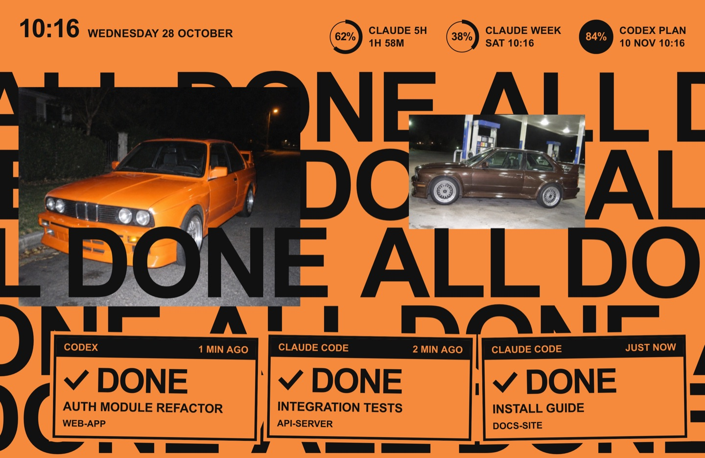
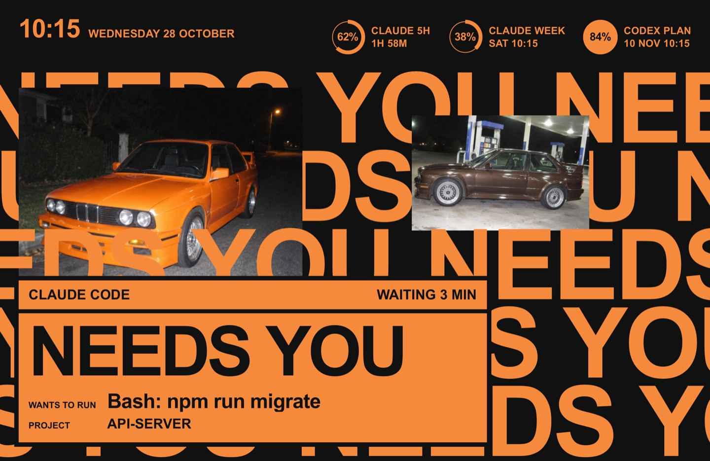
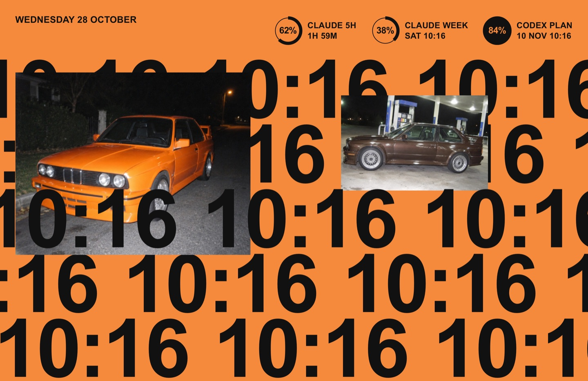
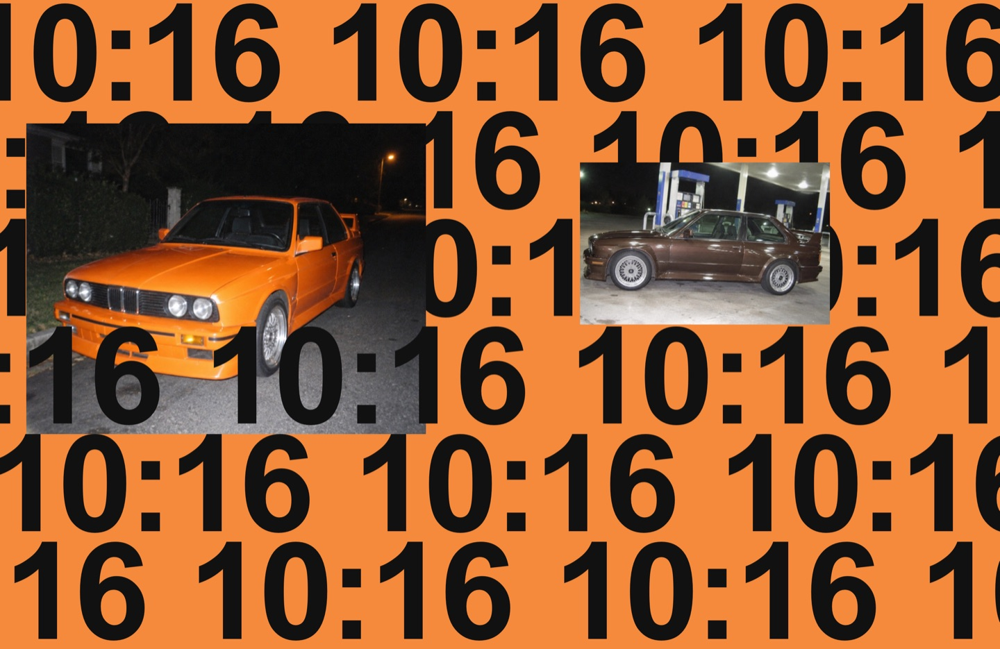

# Pablo

A fan-made tribute theme for agent-screensaver. It is inspired by a stacked-title album cover: a flat orange field, two flat photographs in the upper half, one statement repeated in huge black Arial Bold rows, and one printed card per task. No album artwork or logos are included.


Needs [agent-screensaver 0.3.0](https://github.com/stavgayer/agent-screensaver/releases/tag/v0.3.0) or later.

## What the screen shows

| State | Still |
|---|---|
| Agents working: one black card per task, rows read `STILL WORKING`. |  |
| A task finishes: the card turns into an outlined orange card with `DONE`. When all are done, the rows read `ALL DONE`. |  |
| An agent waits for you: the poster turns black and one large card shows the command. |  |
| Nothing running: the time, repeated. The corner shows the date. |  |
| Second display: the time, repeated. |  |

Privacy mode keeps working. With privacy on, the title and the command are left out.

With "Reduce motion" on in macOS, the rows and the photos stand still, and cards fade in and out without moving.

## What is in this folder

| Folder | Type | What it does |
|---|---|---|
| `stavgayer.pablo` | theme | Picks the ground and the layout. |
| `stavgayer.pablo-layout` | layout | Clock top left, rings top right, the board in the center. A second display shows the board with the time only. |
| `stavgayer.pablo-ground` | background | The flat orange (option `color`), and the black field while an agent waits. |
| `stavgayer.pablo-rows` | component | The board: rows, photos, task cards and the approval card. Option `show`: `agents` (default) or `time`. |
| `stavgayer.pablo-clock` | component | The time and the date. |
| `stavgayer.pablo-rings` | component | The usage limits as flat rings. |

The `media` folder holds the stills for this page. It is not part of the pack zip.

## Install

Download `pablo.zip` from the Releases page of this repo. Open the agent-screensaver settings window (from the menu bar icon, or with Spotlight on 0.3.1 or later), go to Extensions, click Install… and choose `pablo.zip`. Then pick the theme under Theme & background.

Or in Terminal:

```
agent-screensaver ext install pablo.zip
agent-screensaver theme set stavgayer.pablo
```

To build the zip yourself, run `scripts/pack.sh pablo` from the root of this repo.

## Uninstall

```
agent-screensaver ext remove stavgayer.pablo
```

This removes the theme and its parts that no other theme uses. To switch to another theme first, run `agent-screensaver theme set builtin.chrome`.

## Options

To change the orange:

```
agent-screensaver option set stavgayer.pablo-ground color "#f58a3c"
```

## Credits and licences

- Theme code and manifests: MIT, see the `LICENSE` file at the root of this repo.
- Font: Arial, used from macOS. It is not bundled.
- Photos: the two car photos in `stavgayer.pablo-rows/photos` (`orange.jpg` and `brown.jpg`) were generated with an image model for this theme.
- Fan-made tribute. Not affiliated with any artist or label.
