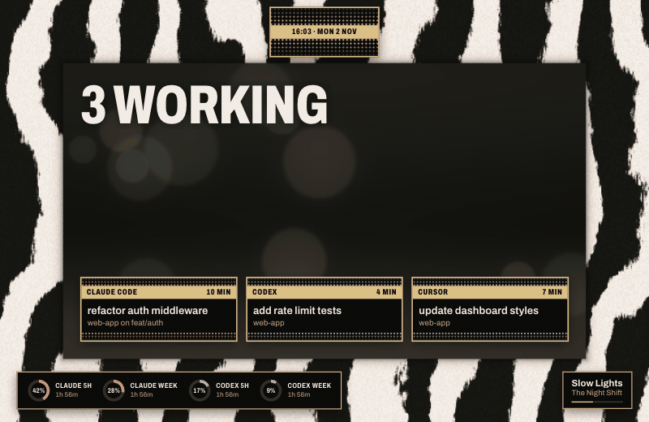
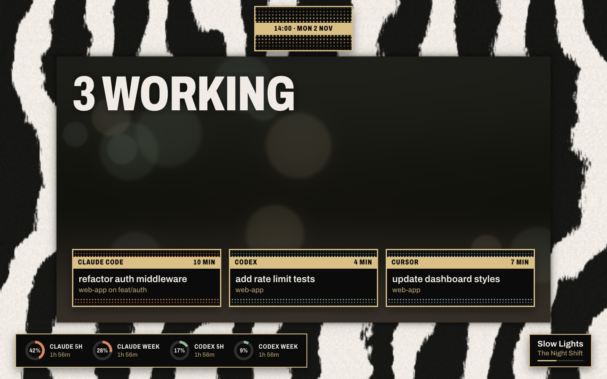
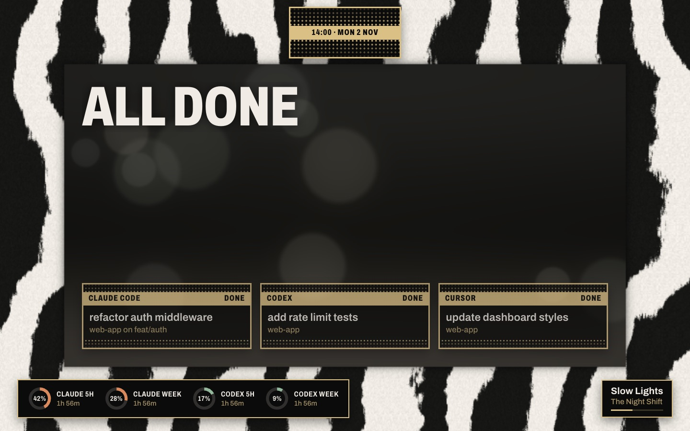
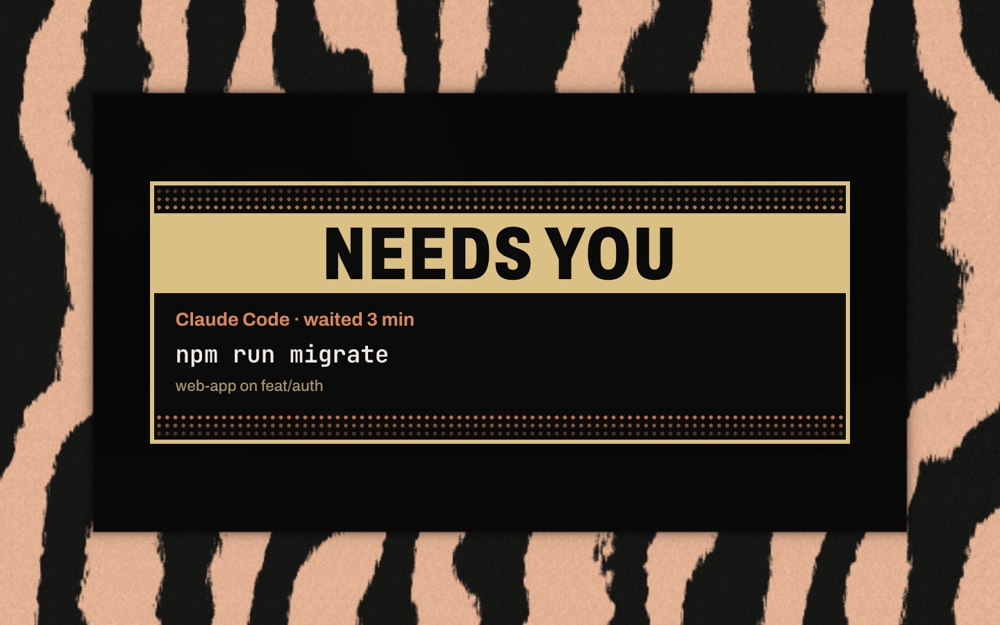
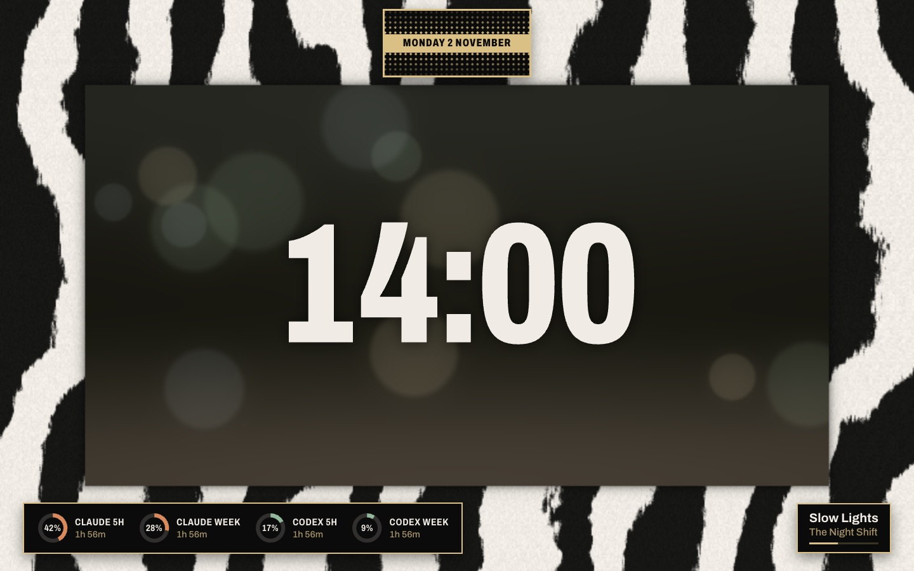
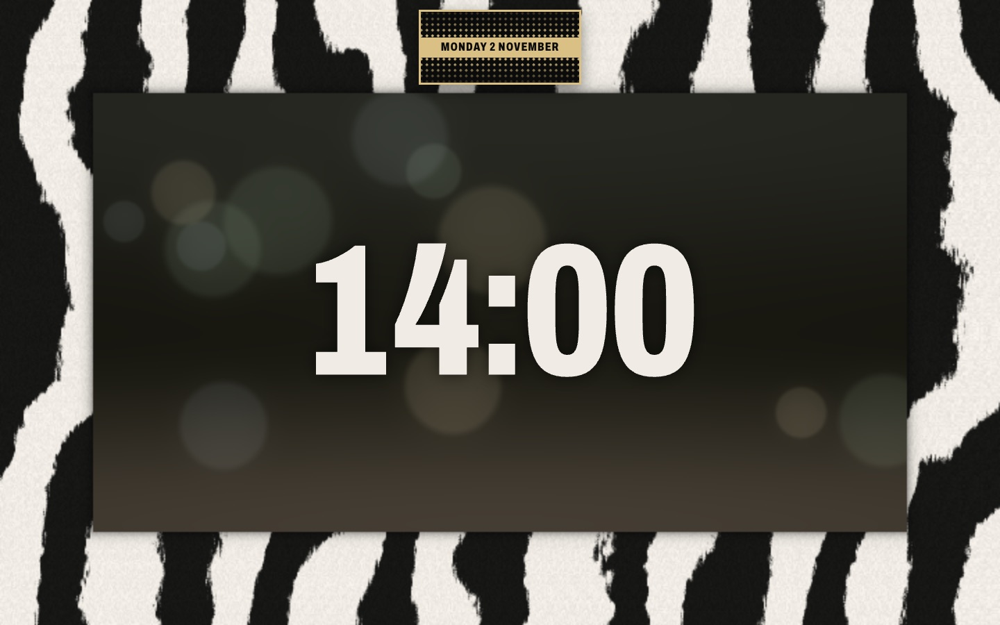

# Piñata

A fan-made tribute theme for agent-screensaver. It is inspired by the cover of Piñata by Freddie Gibbs and Madlib (2014): a square photo set in a thick frame of zebra fur, with a small gold and black name plate above the photo. Here the zebra frame runs around your whole screen, the window in the middle holds the soft light of a park out of focus, and the gold plate carries the date. Each task gets its own small plate in the same style. Everything is drawn in code. No album artwork, photos or logos are included.



Needs [agent-screensaver 0.3.0](https://github.com/stavgayer/agent-screensaver/releases/tag/v0.3.0) or later. The song needs 0.4.0 or later.

## What the screen shows

| State | Still |
|---|---|
| Agents working: the window darkens a little and says `3 WORKING` in big letters. Each task is a small plate at the bottom of the window: a gold band with the agent and how long it has run, then the task and the project, with dots in the agent's colour. More than four tasks (three on 4:3 and 5:4 screens) end with a `+N MORE` plate. |  |
| All done: the park light turns grey and calm, the big word says `ALL DONE`, and every plate says `DONE`. |  |
| An agent waits for you: the light stripes of the fur turn the agent's colour, the window goes dark, and one big plate drops into it: `NEEDS YOU`, the agent, how long it has waited, the exact command and the project. The name plate, the limits and the song step away. |  |
| Nothing running: the frame and the park at rest, the time very large in the window, the date on the gold plate, and the usage limits in the bottom border. |  |
| Second display: the frame, the park, the time and the date only. |  |

With "Show what's playing" on, the song gets a small black plate with a gold frame in the bottom right corner: the title, the artist and a thin gold bar that fills as the song plays. A long name is cut with "…". A song that Music streams has no bar, because Music gives no length for it. The song hides while an agent waits for you.

Each agent owns one colour from the park photo: Claude clay, Codex leaf green, Cursor sky grey. Other agents get a colour by their name. All small text sits on black plates with a gold frame, so it reads over the fur. Privacy mode keeps working: titles, commands and branches show only when the service sends them. Without a command the approval says "Look at the terminal".

## What it took from the cover

These facts were measured from the cover before anything was drawn:

- The fur frame is 20% of the side on every edge, and the photo window is 60%. On screen the frame is 15% of the short side on every edge.
- The stripes run mostly up and down, with about one light and one dark stripe in each fifth of the side. About 47% of the fur is light.
- Light fur is about `#f0ece5`, dark fur about `#161614`.
- The name plate sits centred in the top border, just above the photo. It is 27% of the side wide and 13% high (about 2.16 to 1). It has a gold frame (`#dbc086`), a black field of gold dots that crowd toward a gold band in the middle, and black bold condensed capitals in the band.
- The photo is a park in soft light: dark canopy `#3e4035`, shade `#252519`, path `#6f6353`, leaves `#99b79f`, sky `#90a2b0`, sun `#f2dab6`. The theme uses these colours for the light in the window and for the agents.

## Motion

- The fur drifts about 3% of the short side over 12 minutes, so no pixel stays lit in one place.
- Soft circles of park light float slowly in the window.
- When the state changes, the window and the fur fade to their new colours over about a second.
- An approval is one move: the big plate drops into the window and the fur takes the agent's colour. Nothing pulses.
- The background is a WebGL shader. It draws at half size (option `scale`) and 15 frames a second (option `fps`, at most 30), and it starts again on its own if the graphics card resets.
- With "Reduce motion" on in macOS, the background is drawn once for each change and stands still, and things fade instead of moving.

## What is in this folder

| Folder | Type | What it does |
|---|---|---|
| `stavgayer.pinata` | theme | Picks the background and the layout. |
| `stavgayer.pinata-layout` | layout | The board over the whole screen. A second display shows the board with the time only. |
| `stavgayer.pinata-ground` | background | The zebra fur, the window and the park light. Options: `fps`, `scale`. |
| `stavgayer.pinata-board` | component | The name plate, the big words, the task plates, the approval, the usage limits and the song. Option `show`: `agents` (default) or `time`. |

The `media` folder holds the stills for this page. It is not part of the pack zip.

## Install

Download `pinata.zip` from the Releases page of this repo. Open the agent-screensaver settings window, drop the zip on it or click Install… under Extensions, then pick the theme under Theme & background.

Or in Terminal, with the `agent-screensaver` command set up as the [main README](../../README.md#in-terminal) shows:

```
agent-screensaver ext install pinata.zip
agent-screensaver theme set stavgayer.pinata
```

To build the zip yourself, run `scripts/pack.sh pinata` from the root of this repo.

## Uninstall

```
agent-screensaver ext remove stavgayer.pinata
```

This removes the theme and its parts that no other theme uses.

## Options

To use less power, lower the frame rate or the render scale:

```
agent-screensaver option set stavgayer.pinata-ground fps 10
agent-screensaver option set stavgayer.pinata-ground scale 0.35
```

## Credits and licences

- Theme code and manifests: MIT, see the `LICENSE` file at the root of this repo.
- Font: Archivo, for the big words, the bands and the small text, SIL Open Font License 1.1. Files: `Archivo.ttf` and `OFL-Archivo.txt` in the `fonts` folder of `stavgayer.pinata-board`.
- Font: JetBrains Mono, for the approval command, SIL Open Font License 1.1. Files: `JetBrainsMono.woff2` and `OFL-JetBrainsMono.txt` in the `fonts` folder of `stavgayer.pinata-board`.
- Fan-made tribute. Not affiliated with Freddie Gibbs, Madlib or Madlib Invazion.
