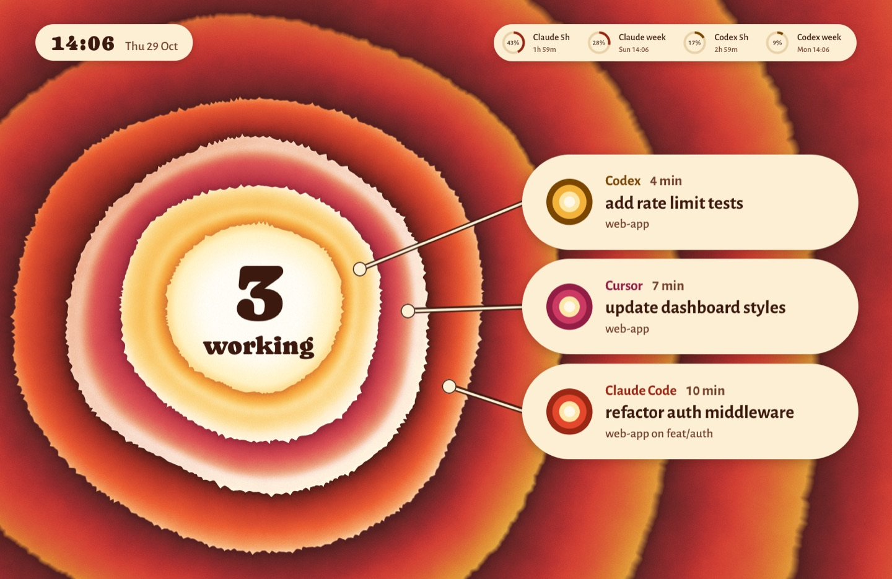
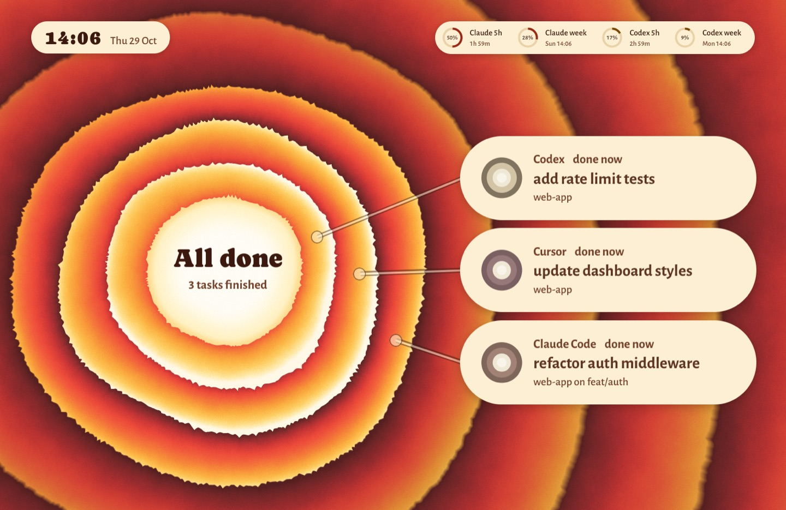
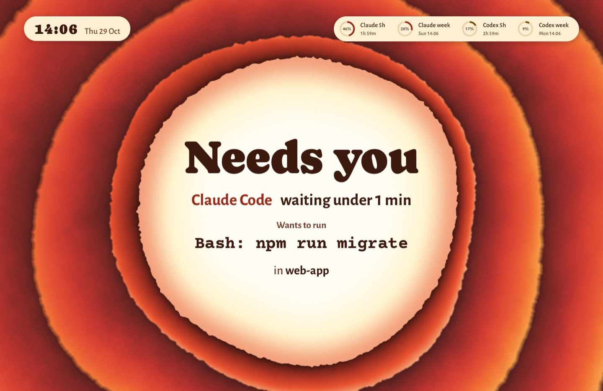
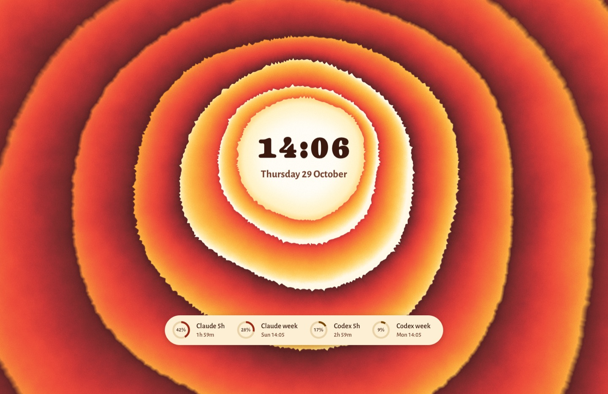
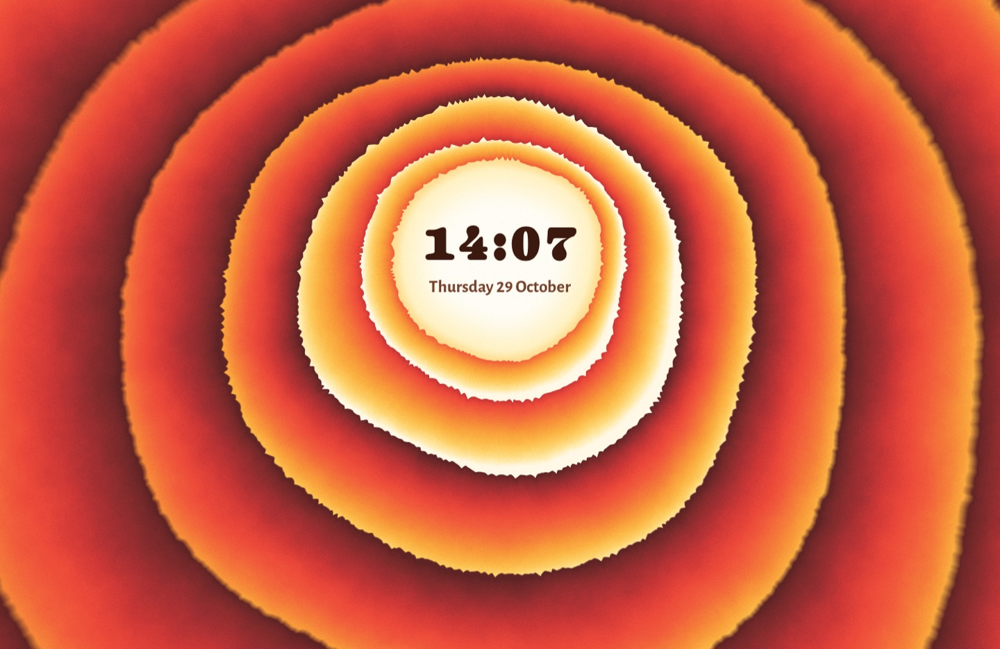

# Key of Life

A fan-made tribute theme for agent-screensaver. It is inspired by a record sleeve from 1976, a double album on Motown's Tamla label, with art direction by the Motown Graphics Department and illustration credited to Tony Warren. The sleeve is a field of torn, wavy rings painted in soft airbrush gradients: deep red and burnt orange at the edge, then orange, amber and a pale glow at the centre, where a small portrait sits. Each ring is lifted off the one below it: dark in the shadow of the next ring in, bright at its own torn edge. Here the rings carry your agents: each task owns one ring, a leader runs from the ring to the task's card, and when an agent needs you the centre opens wide and a wave runs out through the rings. Everything is drawn in code, in a shader, from the proportions and colours of the sleeve. No album artwork, portrait, lettering or logos are included.

Needs agent-screensaver 0.3.0 or later. That release is not out yet.

## What the screen shows

| State | Still |
|---|---|
| Agents working: the field moves left and its centre holds the count, `3 working`. Each task owns one ring between the centre and the cards, tinted toward its agent's colour, and a soft light runs outward through the ring while the task works. The newest task has the ring nearest the centre. A cream leader runs from each ring to its card: the agent in its colour, the time, the task on one or two lines and the project. |  |
| All done: each ring settles and fades back into the colours of the sleeve. The cards say `done`, and the centre says `All done`. |  |
| An agent waits for you: the centre opens to most of the screen, its rim glows in that agent's colour, a wave bursts outward through the rings and the field warms toward the agent's colour. `Needs you` stands large in the centre; under it the agent, how long it has waited, the exact command and the project. |  |
| Nothing running: the sleeve, with its rings as they are on it, thin above the centre and wide below it. The time stands large in the glowing centre where the sleeve has its portrait, the date under it, and the limit rings on a cream label across the lower rings. The rings breathe outward very slowly. |  |
| Second display: the sleeve with the time and the date. |  |

Each agent owns a warm colour: Claude vermilion, Codex gold, Cursor crimson. Other agents get rose, orange or brick by their name. All text is dark brown on cream, in the centre or on cream labels, so it reads on every colour of the field. The approval command keeps one line and gets smaller to fit the centre; a very long command breaks at spaces into up to three lines. Up to seven cards are shown; more cards add a `+2 more` label. Privacy mode keeps working: titles, commands, names and branches are shown only when the service sends them. Without a command the approval says "Look at the terminal".

## Motion

- When a task starts, the rings move outward on a spring to make room for its ring at the centre, and its card lands at the end of its leader.
- When a task finishes, its ring fades back into the palette over about a second, and its card moves a hair as its time line rises in.
- An approval is one move: the centre opens on a spring, a wave runs out through the rings, and `Needs you` lands in the centre a beat later, then who, what and where under it. While the agent waits, a softer wave runs out every 9 seconds.
- At rest the rings breathe outward, a fraction of a percent over 40 seconds.
- The rings sway a little over 8 minutes, so no pixel stays lit in one place. The words stand still: moving text by a fraction of a pixel makes it shimmer.
- The rings are one WebGL draw of one triangle over the screen. It draws only when something changes or moves, at most 30 frames a second (option `fps`), at half the screen's pixels (option `scale`), and not at all while the page is hidden. The breathing, the sway and the light in a working ring take every second frame, so they glide. Cards and words animate only transform and opacity.
- With "Reduce motion" on in macOS, the rings are drawn once for each change and stand still: no breathing, no light, no wave, no sway, and words fade instead of moving.

## What is in this folder

| Folder | Type | What it does |
|---|---|---|
| `stavgayer.sitkol` | theme | Picks the rings and the layout. |
| `stavgayer.sitkol-layout` | layout | The board and the bar over the whole screen. A second display shows the board with the time only. |
| `stavgayer.sitkol-ground` | background | The rings: their torn edges and airbrush colours, the rings of the tasks and their leaders, the open centre and the wave of an approval. Options: `fps`, `scale`. |
| `stavgayer.sitkol-board` | component | The words in the centre (the time, the count, the approval) and the task cards. Option `show`: `agents` (default) or `time`. |
| `stavgayer.sitkol-bar` | component | The time and the date at the top left while tasks run, and the usage limits as rings: at the top right while tasks run, under the centre when nothing runs. |

The `media` folder holds the stills for this page. It is not part of the pack zip.

## Install

Install the pack from this folder:

```
agent-screensaver ext install ./agent-screensaver-sitkol
agent-screensaver theme set stavgayer.sitkol
```

On a release that installs one extension at a time, run this from this folder instead, one folder per install:

```
for e in stavgayer.sitkol-board stavgayer.sitkol-bar stavgayer.sitkol-ground stavgayer.sitkol-layout stavgayer.sitkol; do
  agent-screensaver ext install "./$e"
done
agent-screensaver theme set stavgayer.sitkol
```

## Uninstall

```
agent-screensaver ext remove stavgayer.sitkol
```

This removes the theme and its parts that no other theme uses. To switch to another theme first, run `agent-screensaver theme set builtin.chrome`.

## Options

To use less power, lower the frame rate or the render scale:

```
agent-screensaver option set stavgayer.sitkol-ground fps 15
agent-screensaver option set stavgayer.sitkol-ground scale 0.35
```

The rings never draw at less than one pixel per screen point, so the torn edges stay crisp at any scale.

## Credits and licences

- Theme code and manifests: MIT.
- Font: Caprasimo, by The DocRepair Project, Phaedra Charles and Flavia Zimbardi, for the big words (the time, the count, `Needs you`), SIL Open Font License 1.1. A soft, heavy display serif in the spirit of the 1970s. From Google Fonts (github.com/google/fonts, `ofl/caprasimo`). Files: `Caprasimo.ttf` and `OFL-Caprasimo.txt` in the `fonts` folder of `stavgayer.sitkol-board` and `stavgayer.sitkol-bar`.
- Font: Alegreya Sans, by Juan Pablo del Peral and HT Fonts, for the small words, SIL Open Font License 1.1. From Google Fonts (github.com/google/fonts, `ofl/alegreyasans`). Files: `AlegreyaSans-Medium.ttf`, `AlegreyaSans-Bold.ttf` and `OFL-AlegreyaSans.txt` in the `fonts` folder of `stavgayer.sitkol-board`, and the medium weight in `stavgayer.sitkol-bar`.
- Font: Courier Prime, by Alan Dague-Greene, for the command, SIL Open Font License 1.1. From Google Fonts (github.com/google/fonts, `ofl/courierprime`). Files: `CourierPrime-Bold.ttf` and `OFL-CourierPrime.txt` in the `fonts` folder of `stavgayer.sitkol-board`.
- The history of the sleeve: the Wikipedia article on the record, and the catalogue record of the sleeve in the Wayne State University digital collections, which lists the illustrators and the Motown Graphics Department as art director.
- Fan-made tribute. Not affiliated with any artist, designer or label.
