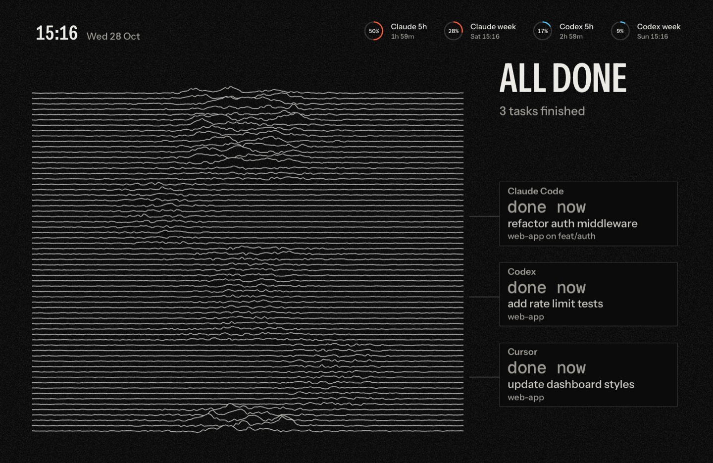
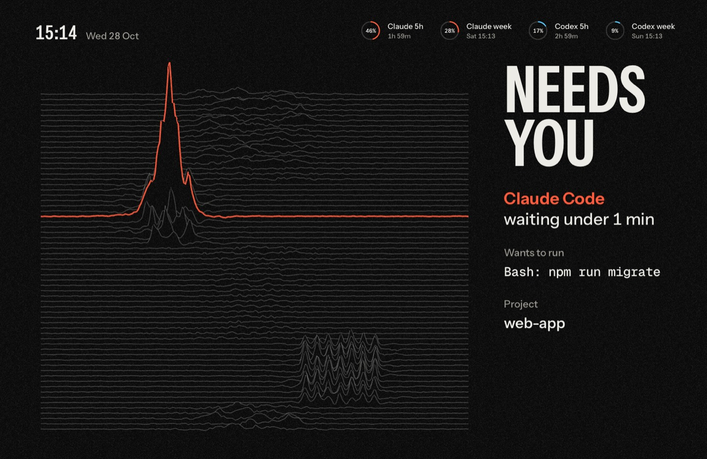
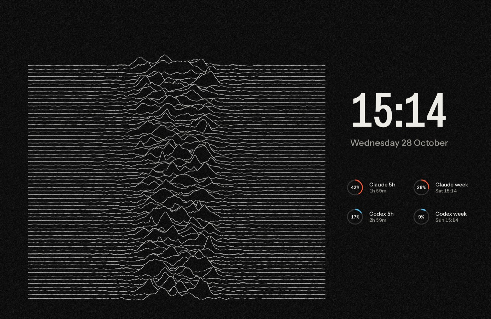
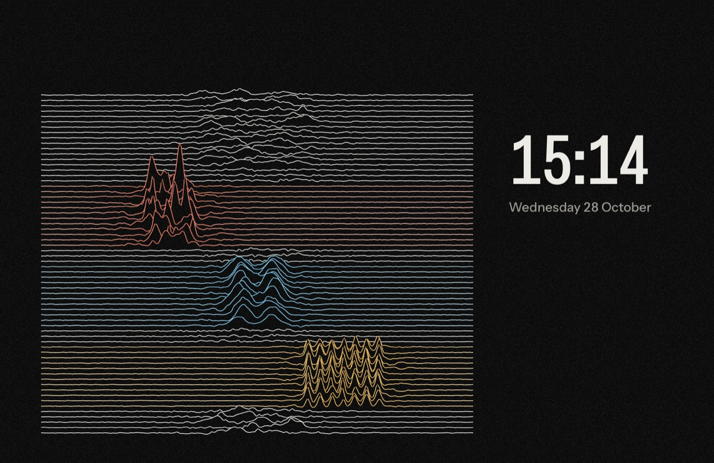

# Unknown Pleasures

A fan-made tribute theme for agent-screensaver. It is inspired by an album cover that was already a graph. In 1970 the radio astronomer Harold D. Craft, Jr. plotted 80 successive radio pulses of the pulsar CP 1919 at the Arecibo Observatory for his Cornell PhD thesis. Each pulse is one short trace, peaking in the middle, and each trace is drawn in front of the one before it, so the nearer peaks hide the lines behind them. The designer of the sleeve found the plot in an astronomy encyclopedia, turned it white on black, printed it on textured card, and put no words on the front. Here the stacked lines are the graph of your agents: each agent owns a band of lines, and its card stands beside that band like a label on the axis of the graph. The lines are drawn in code from our own numbers. No album artwork, plot data or logos are included.


Needs agent-screensaver 0.3.0 or later. That release is not out yet.

## What the screen shows

| State | Still |
|---|---|
| Agents working: the plot fills most of the screen, 64 lines on black. Each task owns one band of lines, and its lines peak while it works, taller the longer it has run. Each band peaks in its own zone across the plot and with its own shape: Claude in needles, Codex in twin shoulders, Cursor in a comb of teeth. Its lines carry the agent's colour, a few quiet lines part it from the band behind, and the pulses roll back through it once every 1.337 seconds, the period of the pulsar. A leader in the agent's colour runs from the band to its card: a black plate in a hairline frame with the agent, the time in large mono figures, the task and the project. `3 WORKING` at the top of the column. |  |
| All done: each band goes flat and settles, like a string coming to rest, and loses its colour. The cards keep a quieter frame and say `done`. `ALL DONE`. |  |
| An agent waits for you: one line of its band rises into a single tall burst in its colour. The burst breaks out of the top of the stack and hides every line behind it, and all the other lines dim. `NEEDS YOU`, large on two lines, then the agent, how long it has waited, the exact command and the project. |  |
| Nothing running: the whole stack, close to the sleeve, breathes slowly. The time very large, the date, and the limit rings under them. |  |
| Second display: the plot with the task bands, and the time and the date only. |  |

Each agent owns one colour: Claude red, Codex blue, Cursor amber. Other agents get colours by their name. Colour stays an accent: the plot is white on black, and colour marks only the lines of a working band, its leader, its name, its rings, and the burst. All text sits on the black card with high contrast. The approval command keeps one line and gets smaller to fit; a very long command breaks at spaces into up to four lines. Privacy mode keeps working: titles, commands, names and branches are shown only when the service sends them. Without a command the approval says "Look at the terminal".

## Motion

- The rolling bands are the only fast motion. Calm lines breathe in a slow wave that passes through the stack every nine seconds.
- When a task finishes, its band goes flat with a small overshoot, its card moves a hair and its time line rises in.
- An approval is one move: the burst rises with a spring, the other lines dim, the words of the column step aside, and `NEEDS YOU` lands a beat later, then who, what and where. Nothing pulses.
- Cards rise in from the right with a spring, 70 ms apart, after their leader draws out from the band.
- The plot sways a few pixels over 4 minutes, drawn with the plot itself so it glides, so no pixel stays lit in one place. The words do not sway: text moved by fractions of a pixel shimmers.
- The plot is one WebGL draw call: the heights of the lines are worked out on the GPU from a few numbers per line. Each line is filled with black before it is drawn, so it hides the lines behind it. It runs at 24 frames a second (option `fps`), at half the screen's pixels (option `scale`), and only over the plot. It stops when the screen saver stops. Cards and words animate only transform and opacity.
- With "Reduce motion" on in macOS, the plot is drawn once for each change and stands still, nothing sways, and words fade instead of moving.

## What is in this folder

| Folder | Type | What it does |
|---|---|---|
| `stavgayer.pleasures` | theme | Picks the plot and the layout. |
| `stavgayer.pleasures-layout` | layout | The board, the clock and the rings over the whole screen. A second display shows the board with the time only. |
| `stavgayer.pleasures-ground` | background | The plot: the stacked lines, the agent bands, the burst for an approval, the paper grain. Options: `fps`, `scale`. |
| `stavgayer.pleasures-board` | component | The column: the statement, the cards and their leaders beside their bands, the approval, the large time. Option `show`: `agents` (default) or `time`. |
| `stavgayer.pleasures-clock` | component | The time and the date, small, over the plot. |
| `stavgayer.pleasures-rings` | component | The usage limits as rings: in the corner while tasks run, under the large time when nothing runs. |

The `media` folder holds the stills for this page. It is not part of the pack zip.

## Install

Download `unknown-pleasures.zip` from the Releases page of this repo, then run:

```
agent-screensaver ext install unknown-pleasures.zip
agent-screensaver theme set stavgayer.pleasures
```

To build the zip yourself, run `scripts/pack.sh unknown-pleasures` from the root of this repo.

On a release that installs one extension at a time, run this from this folder instead, one folder per install:

```
for e in stavgayer.pleasures-board stavgayer.pleasures-clock stavgayer.pleasures-rings stavgayer.pleasures-ground stavgayer.pleasures-layout stavgayer.pleasures; do
  agent-screensaver ext install "./$e"
done
agent-screensaver theme set stavgayer.pleasures
```

## Uninstall

```
agent-screensaver ext remove stavgayer.pleasures
```

This removes the theme and its parts that no other theme uses. To switch to another theme first, run `agent-screensaver theme set builtin.chrome`.

## Options

To use less power, lower the frame rate or the render scale:

```
agent-screensaver option set stavgayer.pleasures-ground fps 15
agent-screensaver option set stavgayer.pleasures-ground scale 0.35
```

The plot never draws at less than one pixel per screen point, so the lines stay sharp at any scale.

## Credits and licences

- Theme code and manifests: MIT, see the `LICENSE` file at the root of this repo.
- Font: Instrument Sans, for all the words (its narrowest width for the big words), SIL Open Font License 1.1. From Google Fonts (github.com/google/fonts, `ofl/instrumentsans`). Files: `InstrumentSans.ttf` and `OFL-InstrumentSans.txt` in the `fonts` folder of `stavgayer.pleasures-board`, `stavgayer.pleasures-clock` and `stavgayer.pleasures-rings`.
- Font: Geist Mono, for the command, SIL Open Font License 1.1. From Google Fonts (github.com/google/fonts, `ofl/geistmono`). Files: `GeistMono.ttf` and `OFL-GeistMono.txt` in the `fonts` folder of `stavgayer.pleasures-board`.
- The history of the plot: Jen Christiansen, "Pop Culture Pulsar", a two-part article on the SA Visual blog of Scientific American, 2015, and the magazine's later article for the plot's 50th birthday.
- Fan-made tribute. Not affiliated with any artist, designer or label.
